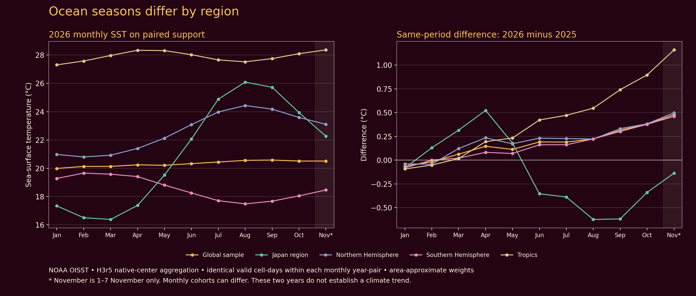

# Anthropocene water temperature — Stage 0 and Stage 1

Research and acquisition date: **Sunday, 8 November 2026**. The ocean snapshot
currently reaches **7 November 2026**, inclusive; requesting 8 November does
not make an incomplete or unpublished day an observation.

The approved scope is three complementary ocean views: **absolute sea-surface
temperature**, **sea-surface temperature anomaly**, and **record-high/record-low
daily-mean SST counts**. Coral thermal stress accompanies the absolute SST
plate, with a separate degree-heating-week key. Land-temperature records,
particulate observations, and historical coral-reef threat remain distinct
Anthropocene subjects.

This implements the [original ocean brief](20261108_anthropocene_ocean_temperature.md)
and the subsequent interactive decisions. The ocean work is a local review
edition; its four canonical year/measure plates are optional prototypes in
the current catalog. Decisions about promoting or publishing them are at the
end of this document.

## Review entry points and presentation

- [Ocean maps and separate legends](../../output/ocean-temperature-20261108/index.html).
- [Mineral maps and separate legends](../../output/mineral-additions-20261108/index.html).
- [Current default atlas](../../output/atlas/index.html).
- [Authoritative plate catalog](../../config/atlas-plates.json).
- [Paired-year comparison data](../../output/ocean-temperature-20261108/data/matched-comparison.json)
  and [JMA comparison](../../output/ocean-temperature-20261108/data/jma-oisst-20261107-comparison.json).

The completed ocean review contains **36 sheets**: SST/coral, anomaly and
record-day views for 2025 full year, 2026 through November 7, and the matched
2025 January–November 7 window; each has World/Japan map and legend pairs.
These are nine review views of the four canonical ocean plate identities,
with record-day and matched-window variants kept in separate folders.

**Yes: these use the separate plate + legend presentation from the
Setouchi/Starlink explorations.** The artwork uses the approved wine
`#240413` / amber `#fcc553` setting, Atkinson Hyperlegible typography,
44 × 19.052559-inch sheets, the retained modified AuthaGraph composition,
and separate World and Japan views. Each map has a matching legend/source
sheet; units, time windows, baseline definitions, missingness and provenance
belong on that sheet. Data colors remain specific to the measure.
See the [saved Setouchi presentation](20261106_setouchi_triennale_futures.md#current-saved-settings--7-november-2026).

New ocean analysis and drawing use **H3 resolution 5**. This does not create
finer ocean observations: the OISST source remains 0.25°. Hexagons containing
no original ocean sample center stay absent. Rasterized data layers are
embedded at 300 dpi in the print sheets; framing and typography remain vector.
PNG proofs, SVG masters and PDFs are separate local files.

All **39 default passes** retain a cartography + data-graphics sheet and a
separate legend/source sheet, for both World and Japan: **156 sheets**.
The current **solar-radiation / Atmosphere** pair now explicitly selects the
approved Setouchi H3r5 edition: amber map background, white nominal 0.66-point
land outlines (0.6525 points after the common sheet-frame scaling), and
100 opacity levels on the shared 0–400 W/m² radiation scale. Its separate
legend retains the wine/amber source-sheet style. This is distinct from
the installed-solar-capacity resource metric, which retains its capacity
classes and units within the same separate-sheet layout.

The retained land-temperature source plates were renamed, not silently
recomputed. In particular, their older observation cutoff is not extended by
the November 8 ocean acquisition. The selected Setouchi H3r5 land gallery
and the older source edition remain individually identified.

## Stage 0 — completed repository, catalog and data work

These are completed changes developed interactively in the terminal, rather
than proposed future tasks. Historical source editions and published release
filenames remain available as provenance and compatibility references.

| Completed item | Result and evidence |
| --- | --- |
| India particulate refresh and enrichment | Acquisition moved to Sunday, November 8; expanded reference-monitor inventory and historical backfill, PM10/hourly detail, separate fire/weather/IITM context, and LongPMInd exploration. The [completed India study](20261108_particulate_data_enrichement_explore_v2_india.md) records actual availability, credentials and quality limits. Its curated package was committed and pushed as `7cbfb1b4cbde75b80036fbdefc5fec7f359deff2`. |
| Canonical Anthropocene names | Land records now use `anthropocene-land-temperature-2025` and `anthropocene-land-temperature-2026`. Ocean SST and anomaly use `anthropocene-water-temperature-YYYY` and `anthropocene-water-temperature-anomaly-YYYY`. Spelling and four-digit years are checked; old land filenames are explicit aliases. |
| Native name migration | Make rules, land generator outputs, preparation profiles, tests and current documentation use the land names. The [migration script](../../scripts/migrate-land-temperature-names.py) preserves the original checked input while producing canonical profile/data paths. |
| Historical reef threat moved | `anthropocene-coral-reef-threat-2011` now belongs to Anthropocene. Its source is still the 2011 WRI threat assessment; the rename does not imply a current reef-condition survey. Compatibility selectors retain access to the old resource generator. |
| Bathymetry demoted | Bathymetry Roulette and Bathymetry Hamonshū are optional prototypes. They are excluded from default plate selection and the standard artifact manifest; explicit generation commands remain available. The ordinary Water plate's depth context is unaffected. |
| Petroleum regrouped | EIA liquids, the OPEC 2030 liquids projection and OPEC country coverage now sit within **Energy resources**, alongside solar, wind, nuclear and refinery throughput. Observations, projections and coverage masks retain separate identities. |
| Mineral coverage expanded | Lithium 2025 and uranium 2024 are implemented mine-production metrics, replacing their planned-only placeholders. A dated extension retains the base resource data and all original observation years. |
| Ocean and coral data added | The 1982–2026 OISST archive supplies the SST, anomaly and record-day calculations. CRW supplies separate 2025 annual, 2025 matched and 2026 YTD thermal-stress fields; a pinned November 7 JMA sample supplies the cross-provider check. The methods and actual coverage are detailed in Stage 1 below. |
| Mineral identity encoded | Rare earths use purple/circles, lithium cyan/squares and uranium amber/triangles in the combined plate. Separate mineral choropleths use the corresponding hue with quantity classes. Symbol shape is a second identity cue. |
| Mineral review sheets added | Separate rare-earth, lithium and uranium sheets plus a combined mineral comparison have World/Japan map and source-sheet pairs: 16 sheets. The combined overview compares countries within each mineral; it has no aggregate mineral tonnage. |
| Catalog and current atlas rebuilt | At Stage 1 completion, the [catalog](../../config/atlas-plates.json) held 45 named plates: **39 defaults and 6 optional prototypes**. Defaults comprise 156 World/Japan map-and-legend sheets. The six prototypes were two Bathymetry plates and four new water-temperature year/measure plates. Stage 2 subsequently added eight optional climate identities. |
| Legend and navigation consistency | Current atlas titles, companion links, source bibliography, group navigation and legend ordinals follow the catalog. Published historical gallery links use explicit legacy stems rather than being redirected to nonexistent renamed release files. |
| Solar-radiation presentation synchronized | The current Atmosphere World/Japan map and legend pairs now adopt the saved November 6/7 Setouchi H3r5 edition. Nineteen pinned presentation inputs preserve the approved amber background, white land outlines, 100 radiation-opacity levels and original October observation dates. |
| Native swarm export repaired | The current sheet-export check exposed a fractional-pixel letterbox at the raster canvas edge. Explicit opaque paper compositing now preserves the exact wine margin while retaining every native circle and paint order. A regression fixture checks both the background and a visible mark. |
| Export ownership and process handling cleaned up | The current atlas exporter owns its PDF/PNG receipts, so unnumbered mineral supplement exports cannot overwrite numbered atlas legends. Parallel Inkscape exports use the existing isolated D-Bus runner; renderer failures now propagate correctly to the caller. |
| Standard artifact graph updated | The [standard manifest](../../contracts/standard-artifact-manifest-v1.json) has 223 native artifacts. Removing twelve Bathymetry projection artifacts and adding twelve lithium/uranium artifacts leaves that total unchanged. This native graph and the 39-plate curated atlas count different deliverables. |
| Lifecycle checks updated | [Pass status](../../contracts/pass-status-v1.json), its schema and validator distinguish optional Bathymetry prototypes from standard land/particulate passes. [Catalog checks](../../scripts/check-atlas-catalog.py) reject identity, group, lifecycle, mineral-coverage and color/shape inconsistencies. |
| Local data provenance separated from bulk caches | Pinned source URLs, hashes, normalized facts, comparison outputs and screen proofs are review artifacts. Large NetCDF caches, annual working arrays and print intermediates remain local and regenerable. No remote publication is implied. |

### Mineral additions: measured quantities and explicit gaps

The [audited additions ledger](../../config/mineral-additions-20261108.json)
contains the transcribed rows, source hashes, units, estimate flags and totals.
[USGS Mineral Commodity Summaries 2026](https://pubs.usgs.gov/periodicals/mcs2026/mcs2026-lithium.pdf)
provides lithium mine output in **tonnes of lithium content**, not lithium
carbonate equivalent. Nine country rows total **288,380 tonnes** against the
rounded **290,000-tonne world estimate excluding withheld U.S. production**:
99.441% of that denominator. U.S. withheld production is missing, not zero.

[BGS World Mineral Production 2020–2024](https://nora.nerc.ac.uk/id/eprint/541620/1/WMP_2020%20to%202024.pdf)
provides uranium mine output in **tonnes of metal content**. Sixteen country
rows sum to **59,725 tonnes**, or 95.56% of the printed **62,500-tonne** world
total. The **2,775-tonne residual remains unallocated**. Russia is absent from
the printed country table; it is not inferred from the residual or patched
with another provider's series. Germany's reported zero is preserved.
Estimated rows remain flagged. The ledger pins the exact PDF and page used;
the factual extract does not redistribute the full BGS compilation.

Rare-earth output is oxide equivalent, lithium is elemental content, and
uranium is metal content. Their dates also differ. The combined map uses
country representative points, not mine locations, and independently scales
each mineral's symbol areas to its own largest producer. Country areas or
symbol sizes must not be interpreted as an all-mineral score. National values
in the Japan viewport do not describe production within individual islands.

### Named passes at Stage 1 completion

The catalog is authoritative; the following inventory makes the reorganized
groups explicit. `YYYY` entries below are separate 2025 and 2026 plates.

| Group | Existing canonical plate IDs |
| --- | --- |
| Projection foundations | `geometry`; `graticules`; `earth`; `water`; `cloud-atmosphere` |
| Networks | `network-cdn`; `network-fiber`; `network-groundstations`; `network-swarm-ge-1080p`; `network-swarm-lt-1080p` |
| Anthropocene, default | `anthropocene-particulate-2025`; `anthropocene-particulate-2026`; `anthropocene-land-temperature-2025`; `anthropocene-land-temperature-2026`; `anthropocene-coral-reef-threat-2011` |
| Anthropocene, optional prototypes | `anthropocene-water-temperature-2025`; `anthropocene-water-temperature-2026`; `anthropocene-water-temperature-anomaly-2025`; `anthropocene-water-temperature-anomaly-2026` |
| Sky and orbital passes | `astro-all-sky`; `astro-observer-ground-multiband`; `astro-observer-hubble`; `orbital-technosphere-global`; `orbital-technosphere-observer` |
| Energy resources | `resources-energy-solar-capacity-2025`; `resources-energy-wind-capacity-2025`; `resources-energy-nuclear-operating-capacity-2024`; `resources-energy-petrochemical-refinery-throughput-latest-2024`; `resources-energy-petroleum-eia-liquids-2025`; `resources-energy-petroleum-opec-liquids-projection-2030`; `resources-energy-petroleum-opec-country-coverage-2026` |
| Food resources | `resources-food-food-production-index-latest-2024` |
| Fauna resources | `resources-fauna-fisheries-production-latest-2024` |
| Flora resources | `resources-flora-forest-area-percent-2024` |
| Minerals | `resources-mineral-rare-earth-mine-production-2025`; `resources-mineral-lithium-mine-production-2025`; `resources-mineral-uranium-mine-production-2024`; `resources-mineral-mine-production-comparison` |
| Human resources | `resources-human-population-under-30-2024`; `resources-human-population-over-60-2024`; `resources-human-upper-secondary-attainment-latest-2025`; `resources-human-bachelors-attainment-latest-2024`; `resources-human-resident-patent-applications-per-million-2019-2021` |
| Bathymetry, optional prototypes | `bathymetry-roulette`; `bathymetry-hamonshu` |

The curated atlas retains its own dated Food/Flora source edition. The base
native resource profile has food-index 2022 and forest-area 2023 inputs;
those were not changed by the mineral extension. A catalog reorganization
does not make these distinct source editions interchangeable.

## Stage 1 — source assessment and implemented ocean method

### Source choice and international checks

Use [NOAA OISST v2.1](https://www.ncei.noaa.gov/products/optimum-interpolation-sst)
as the primary long daily record, acquired through the
[NOAA PSL archive](https://psl.noaa.gov/data/gridded/data.noaa.oisst.v2.highres.html).
It supplies a global 0.25° daily analysis combining satellite and in-situ
inputs. It is an analyzed field, not a thermometer measurement in every cell.
The complete-year baseline starts in 1982; 1981 is partial. Method and input
changes through the record need to remain visible when interpreting extremes.
The [v2.1 evaluation](https://doi.org/10.1175/JCLI-D-20-0166.1) describes these
product changes and their implications.

| Provider / product | Suitable contribution | Access and evidence established in this stage | Boundary |
| --- | --- | --- | --- |
| NOAA OISST v2.1 / PSL | Primary daily SST, climatology, records and monthly aggregation | Yearly SST and ice files, mask, dates and content hashes; 2025 full year and 2026 through November 7 | Recent days are provisional; changing analysis inputs and ice proxies are not resolved by a finer drawing grid |
| [JMA merged global daily SST](https://www.data.jma.go.jp/goos/data/pub/JMA-product/mgd_sst_glb_D/) | Japanese cross-provider check on the same nominal 0.25° grid; archive reaches 1982 | November 7, 2026 file downloaded, decoded and compared at native centers; the [format readme](https://www.data.jma.go.jp/goos/data/pub/JMA-product/mgd_sst_glb_D/Readme_mgd_sst_glb_D) defines ice and missing codes | Shared satellite/in-situ inputs prevent treating agreement as independent truth; only one comparison day has been processed |
| [Copernicus Marine OSTIA reprocessed SST](https://data.marine.copernicus.eu/product/SST_GLO_SST_L4_REP_OBSERVATIONS_010_011/services) | European 0.05° foundation-SST comparison, especially fronts and coastlines | Product catalog, [manual](https://documentation.marine.copernicus.eu/PUM/CMEMS-SST-PUM-010-011.pdf) and [quality document](https://documentation.marine.copernicus.eu/QUID/CMEMS-SST-QUID-010-011.pdf) verified; REP metadata reached March 31, 2026 | November needs a distinct NRT product and a documented REP/NRT seam; no Copernicus files were ingested here |
| [China NSMC FY-3F MERSI-III SST](https://data.nsmc.org.cn/DataPortal/cn/data/dataset.html?dataTypeCode=SST&instrumentTypeCode=MERSI&satelliteCode=FY3F) | Chinese satellite retrieval/composite comparison with day/night and quality distinctions | Official catalog and [product specification](https://img.nsmc.org.cn/PORTAL/NSMC/DATASERVICE/OperatingGuide/FY3F/FY-3F_Product_Instruction_MERSI_SST.pdf) identified | Latest November availability and a bulk acquisition route were not established; short mission history cannot replace the long record baseline |
| [Australia BOM GAMSSA](https://www.bom.gov.au/climate/ocean/sst/) and [IMOS SST](https://imos.org.au/srs-sst-data) | Australian 0.25° foundation analysis and regional higher-resolution quality-controlled retrievals | Official products and [public data access routes](https://imos.org.au/data/access-ocean-data/direct-data-access) verified | Skin/foundation definitions and quality masks differ; BOM's historical monthly series uses NOAA ERSST, so it is not an independent Australian long record |
| [NOAA CPC SST intercomparison](https://cpc.ncep.noaa.gov/products/GODAS/multiSST_body.html) and [ocean briefings](https://www.cpc.ncep.noaa.gov/products/GODAS/ocean_briefing.shtml) | Interpretation, product comparison and ENSO context | Official endpoints checked | GODAS is an assimilating model; CPC context does not supply an independent observational baseline |
| [WeatherWest](https://www.youtube.com/@WeatherWest) | Commentary and pointers to scientific sources | Channel identified; an accessible video transcript was not obtained | No video-specific claim or numeric input is inferred from the channel page |

For regional follow-up, compare identical dates, masks, temperature definitions
and observation support before interpreting differences. A higher-resolution
grid is not evidence of more accurate coastal temperatures. Keep each
provider separate; do not average products together as if they were
independent instruments. No Chinese, European or Australian data have been
quietly substituted into the NOAA record calculations.

### Three views with explicit definitions

| View | Statistic | Display and naming |
| --- | --- | --- |
| Absolute SST | Mean valid daily-mean SST in °C over the labeled interval | `anthropocene-water-temperature-YYYY`; a shared cool-to-warm scale, with an optional coral DHW outline layer |
| SST anomaly | Mean of daily SST minus the same calendar day's **1991–2020** climatology, in °C | `anthropocene-water-temperature-anomaly-YYYY`; zero-centered diverging colors |
| Record days | Count of daily-mean SST values strictly above/below all eligible earlier years for the same calendar date | A `record-days/` view of the water-temperature identity, with separate high/low keys; no claim to daily diurnal maximum/minimum |

The anomaly baseline is computed locally and declared explicitly. NOAA PSL's
distributed anomaly uses **1971–2000**; it is not relabeled as 1991–2020 or
mixed with the locally computed series. Absolute temperature answers how
warm the surface was; anomaly answers how unusual it was for that location
and date. Neither is subsurface ocean heat content.

The [preparer](../../scripts/prepare-ocean-temperature.py) implements:

1. Read the native land/ocean mask and original SST sample centers. Preserve
   legitimate negative SST, missing values and declared packing/ranges.
2. Assign ocean centers to H3r5. Compute each day's mean from **all fixed
   members** of each cell before comparing with history. If any member is
   missing or ice-excluded, that cell-day is missing; a changing within-cell
   sample must not manufacture a record.
3. Exclude samples with a reported sea-ice fraction of at least 0.15. PSL's
   ice field declares percent in one attribute but stores fractions with
   a 0–1 valid range. Its sparse missing ice values outside the ice field do
   not automatically invalidate otherwise valid SST. This is a sea-ice
   screening choice, not a claim that the original SST analysis is ice-free.
4. Build a 366-slot month/day calendar; keep February 29 separate. Require
   at least **24 of 30** valid climatology years for an anomaly. Do not shift
   dates after February in leap years.
5. For a record, require at least **30 valid prior calendar years**, starting
   with 1982. Compare a target before inserting it into history. Thus 2025
   uses earlier years only; 2026 includes 2025. Strict ties are not records.
6. Store SST-valid days, anomaly-valid days, record-eligible days and high/low
   counts separately. Display a period's field only with at least **80%**
   relevant coverage. Missing/insufficient support is distinct from zero
   record days. Counts remain counts, not percentages.
7. Retain monthly arrays and both full-year/YTD and matched January 1–November 7
   products. Use identical scale boundaries between years and geographic views.

Both target years are nonleap. With these strict history thresholds,
February 29 would remain unscored in a future leap-year edition because it
has fewer historical occurrences. Preserve that eligibility gap explicitly;
do not shift March dates or silently borrow neighboring-day observations.

There are **691,150 native ocean centers**, occupying **596,710 H3r5 cells**
before daily quality and coverage screens. This source-center method leaves
visible gaps at finer display resolution. Interpolation or polygon filling
would change the support and requires a separate, documented product.

The completed preparation gives the following display support. These are
counts of supported H3 cells, not equal-area percentages; the counts differ
because the measures have different history/coverage requirements.

| Period | Calendar days | SST cells | Anomaly cells | Record-eligible display cells |
| --- | ---: | ---: | ---: | ---: |
| 2025 full year | 365 | 519,138 | 505,682 | 508,431 |
| 2025 January 1–November 7 | 311 | 518,436 | 505,140 | 508,002 |
| 2026 January 1–November 7 | 311 | 520,826 | 506,788 | 510,358 |

All **91 NOAA input files** were acquired and verified: 45 SST/ice year
pairs and the native land/ocean mask. The independent calculation check
verified all 90 yearly grids and recomputed 32 selected cell-periods from
the yearly arrays, including strict records and calendar-day anomalies.

### Coral thermal stress on the absolute water-temperature plate

Use NOAA Coral Reef Watch's independently defined
[Degree Heating Weeks](https://coralreefwatch.noaa.gov/product/5km/index_5km_dhw.php),
not an arbitrary threshold on the generic SST anomaly. DHW accumulates
qualifying heat stress over a rolling twelve-week window, in **°C-weeks**.
The [annual maximum product](https://www.coralreefwatch.noaa.gov/product/thermal_history/annual_max_dhw.php)
supplies a period maximum: it is not a sum of daily DHW and is not current
bleaching prevalence.

The overlay takes the maximum valid original 0.05° CRW sample inside each
H3r5 cell, limited to the existing **2011 WRI reef-presence locator**. The
locator is historical and coarse; it is not an updated reef boundary or a
survey of surviving coral. The [preparation script](../../scripts/prepare-coral-thermal-stress.py)
retains the CRW input hashes and that distinction.

Each period has 27,372 supported overlay cells. The 2025 full-year maximum
is **30.60°C-weeks**, and 2026 through November 7 is **29.92°C-weeks**. These
different windows do not establish a decline. A separate 2025 January–November 7
input is also pinned for the matched comparison. Outlines use bins below 4,
4–<8, 8–<12, 12–<16, 16–<20 and at least 20°C-weeks. They are **DHW classes**,
not the operational [Bleaching Alert Area](https://coralreefwatch.noaa.gov/product/5km/index_5km_baa.php)
categories, which also depend on current HotSpot conditions.

This gives the main SST map a useful reef heat-stress layer without merging
three unlike concepts: ordinary warm water, accumulated thermal stress and
the WRI historical local-threat assessment. The historical threat plate stays
separate in Anthropocene.

### Actual paired comparisons

The [matched-period calculation](../../scripts/compare-ocean-periods.py)
uses **January 1–November 7 in each year: 311 calendar days**. At each H3 cell
and date, a pair is included only when both years are valid. Both means use
the same cell-days and the same weights, proportional to the sum of
cos(latitude) over their original sample centers. Region membership uses
the H3 center. These are source-supported regional summaries, not an
official global-ocean temperature index.

| Region | Paired cell-days | 2025 SST °C | 2026 SST °C | 2026 minus 2025 °C |
| --- | ---: | ---: | ---: | ---: |
| Global source-supported ocean | 167,205,423 | 20.157 | 20.318 | **+0.161** |
| Japan region: 20–50°N, 120–160°E | 4,830,946 | 21.205 | 21.075 | **−0.130** |
| Northern Hemisphere | 69,994,322 | 22.414 | 22.610 | +0.195 |
| Southern Hemisphere | 97,211,101 | 18.467 | 18.603 | +0.136 |
| Tropics: 20°S–20°N | 54,927,576 | 27.507 | 27.866 | +0.359 |

The paired difference varies by region, including a cooler Japan comparison
region despite a warmer global mean. A one-year difference is neither causal
attribution nor a long-term trend. Complete 2025 annual means must not be
compared directly with 2026 YTD means as though their seasonal windows match.

For the **November 7 JMA/OISST check**, JMA fixed-width integer data were
converted from 0.1°C; the north-to-south latitude order was reversed; 888 ice
and 999 land/undetermined codes were excluded. No spatial resampling was used.

| Native common-valid region | Paired centers | Weighted JMA minus OISST °C | Weighted RMSE °C | 95th percentile absolute difference °C |
| --- | ---: | ---: | ---: | ---: |
| Global | 539,809 | +0.074 | 0.391 | 0.800 |
| Japan: 20–50°N, 120–160°E | 15,605 | −0.043 | 0.520 | 1.050 |

The small mean bias coexists with larger local disagreements, especially in
the Japan region. This one-day test supports checking decoding, alignment
and regional disagreement; it does not establish a multi-year error model
or independence from shared observation inputs.

## Seasonal comparison and continuing acquisition

There is no single month of maximum climate variance. Distinguish the warmest
mean, the largest month-to-month change, interannual anomaly variance, and
an extreme-event count. They answer different questions and can peak in
different months.

The actual paired monthly series already demonstrates this: among complete
2026 months available here, the Northern Hemisphere and Japan region are
warmest in **August**, the Southern Hemisphere in **February**, the tropics
in **April**, and the pooled global sample in **September**. These are
results for this sample and year, not permanent climatological peak-month
assignments. November has only seven days and is excluded from this ranking.



[SVG](../../output/ocean-temperature-20261108/figures/monthly-paired-comparison.svg),
[PDF](../../output/ocean-temperature-20261108/figures/monthly-paired-comparison.pdf)
and [figure provenance](../../output/ocean-temperature-20261108/figures/monthly-paired-comparison.json)
are available separately. These monthly pairs share support within each
year-pair; the cohort can change between months.

| Subject | Seasonal review emphasis | What to retain and compare |
| --- | --- | --- |
| Ocean absolute SST | Local late summer; shoulder seasons for rapid warming/cooling; opposite hemispheres separately | All daily values and twelve monthly means; matched windows; common valid support; local seasonal amplitude and month-to-month change |
| Ocean anomaly and record days | Every month: unusual relative warmth/cold can occur in winter as well as summer | Fixed-baseline daily anomalies, eligible-day counts, record counts and rates; region-specific monthly anomaly variance rather than a globally selected “important month” |
| Coral thermal stress | Each reef region's warm season and the following accumulation window | Daily or period-max CRW fields; rolling twelve-week interpretation across year boundaries; matched annual/YTD maxima, not sums of DHW |
| Land temperature records | Warm-season TMAX highs and cold-season TMIN lows; opposite hemispheres separately | Keep the land measure definitions; record-day denominators and prior-year eligibility; aggregate calendar months from daily inputs |
| India particulate | Delhi's late-October–January episodes, pre-monsoon dust periods and monsoon transitions; validate each region separately | PM2.5 and PM10 separately, station-hour coverage, local dates, monitor class and station cohort; meteorological/fire context separately labeled |
| Atmosphere / radiation | Local solar season plus clouds and monsoon timing; regional transitions | Full calendar coverage at consistent sampling times and quality levels. The current dated JAXA snapshot is not a seasonal climatology |

The particulate seasonal hypotheses and source limitations are developed in
the [India study](20261108_particulate_data_enrichement_explore_v2_india.md).
They should guide sampling, not assign a source or cause to an observed
pollution episode. Ocean winter heatwave interpretation follows a local
seasonal baseline, as discussed in the
[WMO marine-heatwave overview](https://wmo.int/resources/wmo-bulletin/vol-75-2/marine-heatwaves-are-key-tracking-climate-change).

Future daily, monthly, matched-period and revision work is specified in the
[Stage 2 acquisition contract](20261108_anthropocene_ocean_temperature_stage_2.md#shared-method-and-acquisition-contract).
It preserves this edition's hashes and the distinctions among seasonality,
anomaly, event counts and changing observation coverage.

## Stage 2 — separate completed implementation record

The four inferred plate families—marine heatwaves, ocean thermal seasons,
compound coastal heat, and the India heat–particulate pilot—are implemented
and validated. Their methods, actual results, 128 separate map/legend sheets,
four scientific figures and completion evidence are in the separate
[Stage 2 record](20261108_anthropocene_ocean_temperature_stage_2.md).
Their eight year identities remain optional prototypes. The current catalog
has 53 names: 39 defaults and 14 prototypes; this document preserves the
45-name inventory at Stage 0/1 completion.

## Reproduction and verification

Run from the repository root. `TMPDIR` can point to `build/tmp` for large
local renders. Downloading requires network access; the other steps use
pinned local inputs. Source caches are intentionally larger than the curated
review package.

```sh
python3 scripts/migrate-land-temperature-names.py
make prepare-mineral-additions
python3 scripts/build-mineral-plates.py
python3 scripts/build-atlas-defaults.py --skip-exports
python3 scripts/export-setouchi-sheets.py --delivery output/atlas --workers 3
python3 scripts/build-atlas-defaults.py --check

python3 scripts/fetch-ocean-temperature.py --output output/ocean-temperature-20261108/cache/oisst --workers 3
python3 scripts/fetch-ocean-context.py
python3 scripts/prepare-ocean-temperature.py --wait-for-downloads
python3 scripts/prepare-coral-thermal-stress.py
python3 scripts/compare-ocean-periods.py
python3 scripts/compare-jma-oisst.py
python3 scripts/plot-ocean-comparisons.py
python3 scripts/build-ocean-temperature-plates.py
python3 scripts/validate-ocean-products.py

python3 tests/test-ocean-temperature.py
python3 tests/test-native-swarm-background.py
python3 tests/test-inkscape-runner.py
make check-atlas-catalog check-standard-artifact-manifest check-pass-status check-generation-style
```

The numerical tests cover strict record ties and eligibility, target-before-
baseline order, leap-calendar alignment, fixed H3 membership, missing/ice
handling, packed NetCDF decoding, H3 identity and class boundaries. Catalog
and artifact checks cover naming, grouping, default/prototype selection,
missing/zero mineral distinctions and ledger totals. Native resource and
land-temperature generator tests also passed after the naming changes.

**Completed and verified:** all 36 ocean sheets and all 156 current default
atlas sheets have checked SVG/PDF/PNG exports. The
[ocean validation receipt](../../output/ocean-temperature-20261108/validation.json)
records 90 native grids and 32 independently recomputed cell-periods. The
[current atlas validation](../../output/atlas/sources/sheets-validation.json)
confirms the 39 paired passes and the selected solar-radiation styling.
The mineral supplement's 48 SVG/PDF/preview files match their receipts.
All 126 ocean-index, 157 atlas-index and 40 mineral-index local references
resolve. Representative World/Japan maps, legends and the seasonal figure
were visually inspected. Numerical, native-generator, catalog, artifact,
style and export-regression checks passed. Authored-source `git diff --check`
passed; the generated Matplotlib SVG and byte-preserved JMA format readme
retain their original whitespace.

The [acquisition ledger](../../output/ocean-temperature-20261108/data/acquisition-manifest.json)
pins all 91 NOAA files. The [ocean package guide](../../output/ocean-temperature-20261108/GIT-CONTENTS.md)
and [mineral package guide](../../output/mineral-additions-20261108/GIT-CONTENTS.md)
distinguish review artifacts from the bulk caches and local print exports.
The ocean source cutoff is November 7; the edition date is November 8.

## Human-gated decisions after the local review

1. **Promotion and publication:** choose whether the four water-temperature
   prototypes become default atlas plates, and which SST, anomaly or
   record-day variants enter an exhibition/public website. The requested
   local previews and naming changes do not require another approval.
2. **Further source access:** if multi-year European, Chinese or Australian
   comparisons require an account or terms acceptance, decide that at the
   provider boundary after the concrete download scope is known. Public
   documentation discovery is already complete; no credential is needed to
   finish this NOAA/JMA review edition.

All four inferred Stage 2 families have been selected and approved. Their
remaining human decisions are recorded at the end of the
[separate Stage 2 plan](20261108_anthropocene_ocean_temperature_stage_2.md#human-gated-decisions-after-the-local-review).
