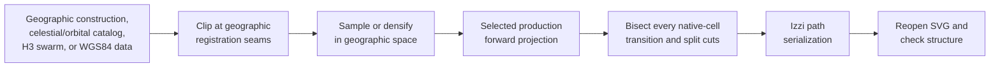

# SVG generation pipeline

[Documentation index](../../../index.md) ·
[Prerequisites](prerequisites.md) ·
[Generation methods](generation-methods.md) ·
[Cahill-Keyes context](../projections/cahill-keyes/context.md) ·
[Astronomy notes](../passes/astronomy.md) ·
[Cloud-atmosphere notes](../passes/cloud-atmosphere.md) ·
[P-Tree download quick start](../data/ptree-download.md) ·
[Orbital Technosphere notes](../passes/orbital-technosphere.md) ·
[Resources Stage 12 implementation](../passes/resources/implementation.md) ·
[Stage 12 overview](../../development/20260815_stage-12.md) ·
[Projection snapshots](build.md#generated-artifact-previews) ·
[Resources enrichment plan](../passes/resources/enrichment-plan.md) ·
[Anthropocene notes](../passes/anthropocene/implementation.md) ·
[Anthropocene Stage 8b plan](../passes/anthropocene/enrichment-plan.md) ·
[Network-swarm notes](../passes/network-swarm.md) ·
[Default generation styles](generation-styles.md) ·
[Network-infrastructure notes](../passes/network-infrastructure.md) ·
[Fiber Synthesized notes](../passes/network-fiber.md) ·
[Bathymetry Roulette notes](../passes/bathymetry/roulette.md) ·
[Bathymetry Hamonshū notes](../passes/bathymetry/hamonshu.md)

## Purpose

The repository contains seventeen C++20 SVG generation programs under
`src.generate/`.
Fourteen exercise all six production projections through the real Alpha60 and
Izzi APIs. Three derive Cahill-Keyes or Myriahedral slices from an already
projected whole-earth SVG. They write layered SVGs under each
`assets.generated/PROJECTION/svg/` directory, then reopen those files and verify dimensions, layer
structure, path counts, and numeric sanity. Inkscape subsequently exports each
validated SVG as PDF and as a 3840-pixel-long-side PNG.

A separate C++20 profile resolver validates the user-configurable projection
and pass selection used by a bare `make`. It chooses existing Make targets; it
does not duplicate generation logic or filter SVG layers after generation.

For the complete current-data workflow, run `make data-update`, followed by
`make ASSET_JOBS=2 atlas-optional`. A selected validated edition is required
for builds; `DATASET=legacy` selects the historical repository workflow.
`make all` builds the native set, while `make atlas` builds the default
World/Japan atlas. See [dataset selection](#updating-all-configured-data-sources)
and [presentation settings](generation-styles.md#setouchi-st2-print-layout).

| Artifact | Generator | Principal input |
| --- | --- | --- |
| Geometry | [`src.generate/generate-geometry.cc`](../../../src.generate/generate-geometry.cc) | Native projection faces and screen quadrants |
| Graticules | [`src.generate/generate-graticules.cc`](../../../src.generate/generate-graticules.cc) | Sampled latitude and longitude lines |
| Earth | [`src.generate/generate-earth.cc`](../../../src.generate/generate-earth.cc) | Natural Earth 1:10m ocean and land |
| Water | [`src.generate/generate-water.cc`](../../../src.generate/generate-water.cc) | Every other Natural Earth 1:10m physical layer |
| Bathymetry Roulette | [`src.generate/generate-bathymetry-roulette.cc`](../../../src.generate/generate-bathymetry-roulette.cc) | Twelve Natural Earth depth thresholds clipped over explicit, filled Izzi roulette fields |
| Bathymetry Hamonshū | [`src.generate/generate-bathymetry-hamonshu.cc`](../../../src.generate/generate-bathymetry-hamonshu.cc) | The same depth field architecture using twelve source-indexed Izzi Hamonshū wave motifs |
| Astronomy | [`src.generate/generate-astro.cc`](../../../src.generate/generate-astro.cc) | Dual ground/Hubble observer profiles, SGP4 Hubble state, bounded Gaia/exoplanet/SBDB snapshots, curated sources/events, and physical planet-size cues |
| Cloud-atmosphere | [`src.generate/generate-cloud-atmosphere.cc`](../../../src.generate/generate-cloud-atmosphere.cc) | Process-start solar geometry plus prepared, source-timed JAXA P-Tree cloud and JAXA Earth atmosphere observations |
| Orbital Technosphere | [`src.generate/generate-orbiting.cc`](../../../src.generate/generate-orbiting.cc) | Profile timestamp and observer, CelesTrak OMM population and memberships, NASA SSCWeb reference positions, and SGP4 |
| Resources Stage 12 | [`src.generate/generate-resources.cc`](../../../src.generate/generate-resources.cc) | Pinned current-source country and reef fields for energy, food, fauna, flora, mineral, and human families |
| Anthropocene particulate | [`src.generate/generate-anthropocene-particulate.cc`](../../../src.generate/generate-anthropocene-particulate.cc) | Complete-2025 and partial-2026 checksum-pinned H3 cell-day counts from GSN, EPA AirData, HMS, Storm Events, and CWFIS |
| Anthropocene temperature | [`src.generate/generate-anthropocene-temperature.cc`](../../../src.generate/generate-anthropocene-temperature.cc) | Complete-2025 and partial-2026 CPC temperature fields on a global H3 domain |
| Network swarm | [`src.generate/generate-native-swarm.cc`](../../../src.generate/generate-native-swarm.cc) | Native Alpha60 cumulative weighted circles; separate 1080p/4K and 720p/SD plates |
| Network infrastructure | [`src.generate/generate-network-infrastructure.cc`](../../../src.generate/generate-network-infrastructure.cc) | Manifested cloud/CDN sites plus explicitly opted-in TeleGeography cable and Internet-exchange topology |
| Fiber Synthesized | [`src.generate/generate-fiber-synthesized.cc`](../../../src.generate/generate-fiber-synthesized.cc) | Checked cleanup/union of 2022 and 20260805 cable snapshots, with 20260805 as the default layer |
| Four slices | [`src.generate/generate-4-slice.cc`](../../../src.generate/generate-4-slice.cc) | Four full-height, quarter-width quadrant-pair enlargements from the Cahill-Keyes Earth SVG |
| Eight slices | [`src.generate/generate-8-slice.cc`](../../../src.generate/generate-8-slice.cc) | Eight exact-octant enlargements from the Cahill-Keyes Earth SVG |
| Myriahedral groups | [`src.generate/generate-myriahedral-slices.cc`](../../../src.generate/generate-myriahedral-slices.cc) | Two complementary exact-terminal-face masks from the Myriahedral water SVG |

The aggregate target generates all four terrestrial artifact families,
astronomy and two Orbital
Technosphere products, 15 resource products plus the Anthropocene reef-threat plate, one
Anthropocene observation atlas, two year-bearing Anthropocene temperature
atlases, one cumulative
network-swarm product, and one cloud/CDN infrastructure-site atlas for all six
production projections, five exploratory
Myriahedral water perspectives, all 12 Cahill-Keyes slices, and two
Myriahedral face-group slices:

```sh
make all
```

The separate exploration aggregate builds every implemented local
non-release experiment while leaving the standard artifact graph and both
publication paths independent:

```sh
make list-experiments
make all-experiments-fetch
make all-experiments
make check-all-experiments
```

Its checked eight-builder registry contains the Stage 15 GPU controls,
proposed consumer object-tree layout, Majuro evidence canary, Marshall Islands
speculations, Stage 16J Equal Earth positioning comparisons, full Majuro
evidence pass, synthetic PurpleAir interface, and bounded water-debris
experiment. It deliberately excludes data fetchers, external
authorization, feasibility-only proposals, hardware benchmarks, GitHub
release, and UCB AAO/S3 upload. Some experiments require their documented
frozen or released parent artifacts; the aggregate does not silently replace
them with unrelated data. On a fresh host, run `make all-experiments-fetch`
before the aggregate to fetch and update every external experimental source —
Natural Earth, astro, orbiting, atoll evidence, and the JAXA P-Tree trust
anchor and data. The fetch target is separate: the aggregate registry itself
still contains no fetch, external authorization, or publication target.

## Updating all configured data sources

```sh
make install-prerequisites
make check-prerequisites
make data-update
make ASSET_JOBS=2 atlas-optional
```

`data-update` captures one UTC calculation boundary, acquires into an isolated
edition, prepares normalized inputs, and validates their hashes, profiles,
coverage and scientific invariants. Only then does it atomically select
`.cartofreako/data/current.json`. It does not render or clean existing maps.
The default update stops at the first failed source and leaves the prior
edition selected. The resilient target continues independent sources and
saves an incomplete run until all required sources are available. Successful
updates print the dataset ID, acquisition modes and
actual source periods. A retrieval date is not an observation date.

`make update-data` is an alias for `make data-update`, including its arguments,
credentials, validation and failure behavior. Requesting both in one invocation
runs acquisition once.

The India adapter runs
[`fetch-india-openaq-pm25.py`](../../../scripts/fetch-india-openaq-pm25.py)
for the configured Indian station inventory from January 2025 through the
run's observation cutoff. It refreshes archive listings to discover new days,
but preserves downloaded daily files across dates, retries and new editions.
The shared cache lives under `${DATA_ROOT}/cache/india-openaq` (default
`.cartofreako/data/cache/india-openaq`). Existing daily files in earlier editions,
the checked India source directory and local India enrichment outputs are
imported without requesting their contents again. Recorded checksums are
verified; a mismatch stops acquisition instead of silently replacing the file.
Per-file receipts distinguish downloads, imports and cache reuse. Explicit
manual `--refresh-since YYYY-MM-DD` permits intentional revision checks;
the aggregate never supplies it. `--reuse-from /path/to/earlier/raw` can import
another local archive directory. Earlier editions keep their original bytes
even after an explicit refresh.

India validation uses the product crosswalk's monitor classes: OpenAQ's
`air-sensor` label supplies the `low-cost` class. Normalized station coordinates
use 12 decimal places to remove floating-point serialization noise; raw archive
bytes are retained. Actual coordinate changes still fail the station metadata
check, and both monitor classes require eligible observations in the shared
current-year window.

See the [optional-source coverage audit](../../development/20261109_data_update_source_coverage.md)
for standalone research fetchers and deliberately pinned inputs outside the
current update workflow.

OISST remote refreshes are limited to the 2025 and 2026 product years:

| Ocean input | Coverage | Acquisition |
| --- | --- | --- |
| SST and sea-ice concentration | 2025 full year and 2026 year to date | Four annual files, using HTTP freshness checks and resumable 8 MiB ranges |
| Historical SST and sea-ice concentration | 1982–2024 | 86 verified local annual files; no provider requests |
| Land mask | Fixed grid | One verified local file; no provider request |

The historical files and land mask are copied from `OCEAN_HISTORY_DIR`
(default `output/ocean-temperature-20261108/cache/oisst`), with receipt,
checksum, and grid verification. These local inputs support the 1991–2020
anomaly baseline and historical records; the output years remain 2025 and
2026. Missing local history fails preflight instead of starting an automatic
45-year download. Set `OCEAN_HISTORY_DIR=/path/to/verified/cache/oisst`
when the existing archive is elsewhere.
Existing prepared ocean arrays beside that archive are also reused when their
input and implementation hashes match; changed inputs are recomputed.
This limits remote acquisition while retaining the full scientific input
range. Historical grids may still require local processing. The target
products include full-year 2025, a matched 2025 window, and 2026 year to date;
the actual common provider coverage and requested cutoff determine the
matched window.

The standalone `fetch-ocean-temperature.py` also defaults to
`--start-year 2025 --end-year 2026`. Its `--history-dir` option stages verified
older inputs. Broader remote ranges require an explicit `--start-year`;
the current-edition adapter always supplies 2025 and 2026.

The four refreshed OISST files use HTTP revalidation; CPC retains closed years and
requests only missing 2026 daily observations. Interrupted HTTP transfers
resume only with matching validators; changed remote identities restart.
OISST downloads use verified 8 MiB byte ranges. CPC whole-year refreshes,
when explicitly requested, use verified 2 MiB ranges. Both retry truncated
response bodies, read timeouts and connection resets within the request/range
retry budget, preserving validated partial bytes. Cached objects, completed
daily subsets and partial transfers survive failed runs. Time inventories checked on the
same UTC day are reused; receipts retain the actual provider-check time.
For local hourly progress reports and CPC completion estimates, see the
[progress reporter](../../development/data-update-hourly-progress.md).
CelesTrak retains its two-hour request policy. The optional NASA SSC reference
may remain explicitly historical. Network, groundstation and audited annual
publication inputs are copied and labeled as pinned local data; no external
checkout is pulled. The configured product years remain 2025 and 2026.

Astronomy requests use bounded retries, honor
`Retry-After`, and reuse successful requests on the same UTC day. Gaia falls
back from ESA to the official ARI DR3 partner service using the same query.
`ASTRO_HTTP_RETRY_BUDGET` overrides the general `DATA_HTTP_RETRY_BUDGET`;
standalone fetching falls back to 60 seconds when neither is set. Make exports
the general budget, normally 1800 seconds. Persistent NASA Exoplanet
Archive maintenance still stops acquisition; failed queries do not replace
previous catalogs or the selected edition. See the
[astronomy acquisition notes](../passes/astronomy.md#source-evaluation-and-bounded-snapshots).

The full `atlas-optional` aggregate runs prerequisites, the two-pass native
`all-resilient` build, fresh atlas composition/export, all Stage 1 ocean
measures and matched periods, and Stage 2 preparation/rendering/validation.
It includes all eight implemented optional climate identities, their figures
and diagnostics. Optional status and scientific definitions remain unchanged.
Building consumes local selected inputs and does not refresh providers.

Every recursive Make and Python process receives the same immutable manifest.
A concurrent activation cannot switch either resilient pass. Current builds
reject conflicting profile overrides. Without an active edition, a current
build stops with instructions to update or explicitly choose legacy mode.

```sh
# Inspect the selected immutable manifest path.
python3 scripts/dataset-context.py --print

# Rebuild an earlier validated edition without provider access.
make DATASET_MANIFEST=/absolute/path/to/edition/dataset.json atlas-optional

# Historical repository snapshots and retained presentation deliveries.
make DATASET=legacy all-resilient
make DATASET=legacy atlas
```

The full build creates a separate run under
`output/data-editions/<dataset-id>/builds/<build-id>/`. It contains `native/`,
`atlas/`, `anthropocene-optional/ocean/`, `anthropocene-optional/climate/`,
and `validation/`. Standalone subset commands use the corresponding folders
directly under `output/data-editions/<dataset-id>/`. SVG metadata and receipt
hashes trace exports to their inputs. The full-build receipt and
`.cartofreako/data/build-current.json` advance only after every group passes.
The previous completed output run stays intact when a rebuild fails.

For interrupted work, use the IDs printed in the error log:

```sh
make data-update DATA_UPDATE_ARGS='--resume <failed-update-id>'
make atlas-optional ATLAS_OPTIONAL_ARGS='--resume <failed-build-id>'
```

Resume verifies completed bytes and implementation fingerprints; changed
methods require a new run. After updating downloader code, use `make data-update`
without `--resume`: completed HTTP cache objects and identity-checked partial
downloads survive between runs, so a new run can revalidate/reuse those bytes.
The old failed run remains available for inspection; its fingerprint is not rewritten.
The fingerprint also includes the Git revision and tracked working-tree status.
Finish edits and commits before starting acquisition. Use a separate checkout
for code or documentation changes while an update is running.

When all sources completed and only final validation failed, a validator fix
can be applied after the updater stops, then checked against those frozen inputs:

```sh
make data-update DATA_UPDATE_ARGS='--validate-completed <failed-update-id>'
```

This path requires verified acquisition completion, all required source
checkpoints, unchanged product definitions, and matching file hashes. It runs
the final native loaders and full manifest validation, and selects the edition
only after they pass. It performs no acquisition or preparation. The manifest
retains the original acquisition fingerprint in `implementation` and records
the validation code separately in `validation.implementation`. Incomplete
acquisitions and acquisition-method mismatches still require the ordinary
resume or new-run workflow. Older journals that record the final native-loader
failure are also supported.

`DATA_UPDATE_ARGS='--candidate-only'` validates
without activation. `DATA_ROOT=/large/local/filesystem/cartofreako-data`
relocates the input store. The default preflight working-space budget is
160 GiB free, excluding final print exports; adjust `DATA_UPDATE_MIN_FREE_GIB`
only from measured local storage needs. Inputs and referenced caches survive
`make clean`; deletion is an explicit storage-management operation.

### Resilient data updates

| Command | Behavior |
| --- | --- |
| `make data-update` | Acquire, prepare, validate and select a complete edition; stop on the first source failure. |
| `make update-data` | Alias for `data-update`. |
| `make data-update-resilient` | Continue independent source groups after failures and checkpoint successful work; validate and select the edition when every required source completes. |
| `make all-resilient` | Build native plates from the selected local edition using the existing resilient build passes. |
| `make atlas-optional` | Build the complete standard, atlas and optional plate set from one selected edition. |

Both acquisition targets reuse the same caches. The resilient target adds
`--keep-going` to `scripts/data-update.py` while preserving other
`DATA_UPDATE_ARGS`. It supports the current-edition workflow; omit
`DATASET=legacy`.

Unless `--candidate-only` is set, a successful run of either acquisition target
already selects the new edition in `DATA_ROOT/current.json`. Continue with
`make atlas-optional`. Running `make data-update` after a successful resilient
update starts another acquisition run.

```sh
# Try every source; a provider outage does not stop unrelated work.
make data-update-resilient

# Attempt astronomy with a 10-minute retry budget per request.
ASTRO_HTTP_RETRY_BUDGET=600 make data-update-resilient

# Known NASA outage: acquire the other required inputs without trying astronomy.
make data-update-resilient DATA_UPDATE_ARGS='--defer astronomy'

# When NASA recovers, retry pending sources and reuse completed checkpoints.
make data-update-resilient DATA_UPDATE_ARGS='--resume <run-id>'

# Continue an incomplete run while explicitly retaining a known deferral.
make data-update-resilient \
  DATA_UPDATE_ARGS='--resume <run-id> --defer astronomy'
```

Without `--defer`, the updater attempts astronomy, including NASA exoplanet
data. Make supplies a default retry budget of 1800 seconds (30 minutes) per
request. `ASTRO_HTTP_RETRY_BUDGET=600` changes astronomy requests to 10 minutes;
the complete astronomy stage can take longer because it includes multiple
queries and Gaia fallback attempts. If astronomy fails, the resilient runner
records the failure and continues independent sources.

`--defer SOURCE` is repeatable and applies only to that invocation. A resume
without the flag retries the deferred source. Already completed sources are
checksum-verified and skipped. Resuming keeps the run's original calculation
boundary and implementation fingerprint. A new run selects a new boundary
and reuses shared cached inputs. After changing acquisition code, start a new
run rather than resuming a journal made by the older implementation.

Dependencies are respected: astronomy needs orbital data; ocean context needs
ocean and resources; India validation needs ocean context. A failed or deferred
prerequisite blocks its dependents while other sources continue. For example,
`--defer ocean` also blocks ocean context and India. Deferred and failed sources
remain required for the complete edition.

The journal at `DATA_ROOT/runs/<run-id>/state.json` records validated source
checkpoints, the current source, and failed, deferred, blocked or invalidated
sources. Hourly progress reports display those issues and the source actually
running. If context preparation changes shared ocean inputs and then fails,
that ocean checkpoint is invalidated and rebuilt on resume. Unexpected changes
to other completed sources stop the update rather than blessing new hashes.

When required sources remain pending, the run ends as `incomplete`, returns a
nonzero exit status, prints a resume command, and leaves the prior active
edition untouched. It creates no usable partial manifest and does not run the
final full-edition validation. After every source completes, the normal full
validation and atomic selection still apply. Prerequisite, credential, storage,
checksum and implementation checks remain enforced.

### Update and build configuration

| Setting | Default | Applies to |
| --- | --- | --- |
| `DATASET` | `current` | Builds select a validated edition. `legacy` explicitly selects retained repository paths; `data-update-resilient` requires current-edition mode. |
| `DATASET_MANIFEST` | Active edition in `DATA_ROOT/current.json` | Replay a specific validated edition by absolute manifest path, independently of the current selection. |
| `DATA_ROOT` | `.cartofreako/data` | Acquisition journals, editions, shared caches and selection pointers; does not relocate rendered outputs. |
| `OCEAN_HISTORY_DIR` | `output/ocean-temperature-20261108/cache/oisst` under the repository root | Verified 1982–2024 OISST annual files, land mask and matching `.nc.json` receipts. Independent of `DATA_ROOT`; never fetched automatically. |
| `DATA_UPDATE_MIN_FREE_GIB` | `160` | Minimum free working space checked before acquisition. |
| `DATA_UPDATE_AS_OF` | Current UTC instant | Environment variable selecting the acquisition calculation boundary; use an explicit UTC ISO timestamp. |
| `DATA_UPDATE_ARGS` | Empty | Arguments to the updater: `--resume ID`, `--validate-completed ID`, repeatable `--defer SOURCE`, `--candidate-only`, `--as-of UTC`, and `--jobs 1`, `2` or `3`. Resilient Make adds `--keep-going`. |
| `ASSET_JOBS` | `2` | Render/export workers and the first resilient native build pass; the retry pass remains serial. It does not control provider request pacing. |
| `ATLAS_OPTIONAL_ARGS` | Empty | Arguments to the full build coordinator; `--resume BUILD_ID` retries its failed output run using the same edition and implementation. |
| `ATLAS_PYTHON` | `.venv-data/bin/python` when available, otherwise `python3` | Scientific interpreter used by acquisition and full-build coordination. |
| `ASTRO_HTTP_RETRY_BUDGET` | Inherited HTTP budget, normally `1800` through Make | Environment override for each astronomy request. Direct script fetching falls back to `60` only when neither retry budget is set. |

Set Make options on its command line and environment-only options before it:

```sh
DATA_UPDATE_AS_OF=2026-11-10T23:00:00Z \
  make data-update-resilient DATA_ROOT=/large/local/cartofreako-data \
  DATA_UPDATE_ARGS='--defer astronomy --jobs 2'

make DATA_ROOT=/large/local/cartofreako-data ASSET_JOBS=2 atlas-optional
```

The example timestamp is an explicit historical boundary; omit it for current
acquisition. The build uses the selected edition's boundary. Changing a
worker count does not advance the observation cutoff or refresh inputs.

### NOAA download controls

CPC acquisition retains closed years and existing current-year observations.
Only missing 2026 daily observations are downloaded. Shared HTTP objects and
partial downloads live under `DATA_ROOT/cache/` (default
`.cartofreako/data/cache/`). The edition coordinator binds every adapter to
`DATA_ROOT/cache`; standalone fetch scripts can use `DATA_HTTP_CACHE` to
select a different shared HTTP cache.
Direct legacy fetches preserve their existing readable NetCDF files.
Scientific coverage checks and the 1979–2026 input range remain unchanged.

Historical CPC files can be imported once from the older local dataset:

```sh
python3 scripts/import-cpc-archive.py
```

The [importer](../../../scripts/import-cpc-archive.py) verifies 1979–2025
TMAX/TMIN against the source `SHA256SUMS` and checks that GDAL can read each
variable. It preserves already refreshed HTTP-cache copies in preference to
older local bytes, then imports the remaining files into the shared
content-addressed cache. Existing archive pins are retained on repeated imports.
`--source` selects another raw directory and `--cache` selects another cache.
The older source files and HTTP partial downloads remain intact.

Subsequent updates stage these 94 pinned archives without provider requests.
2025 is complete and receives no routine freshness checks. Archive
receipts preserve their provenance and actual known retrieval/provider-check
times; unknown historical times remain null. Importing does not select an
incomplete edition. The new edition still needs all source and scientific
validation before activation. To revalidate historical files for an explicit
update, pass `CPC_ARCHIVE_CACHE=0`. Starting a new run is required after
changing acquisition code; shared cached objects remain reusable.

The archive index and import summary live under `cache/cpc-archive/`.
Hourly progress reports include the pinned archives in their cached-file
counts and exclude them from estimated provider requests.

For 2026, [`fetch-cpc-current-year.py`](../../../scripts/fetch-cpc-current-year.py)
imports the most complete checksum-verified local prefix for each variable.
It checks NOAA's small NCSS time inventory once per UTC day, then requests
one native-grid NetCDF subset for each missing day. Existing daily arrays and
their scientific metadata are retained. Grid orientation, units, missing-value
encoding and exact dates must match before appending through libnetcdf.
There is no spatial resampling or byte append to a changing annual download.
Year files are assembled privately and published only after validation.

The prefix and daily subsets live under `cache/cpc-current/`, with immutable
content-addressed objects and per-day HTTP receipts. Restarts reuse verified
daily subsets across UTC days. A failed request leaves the previous year
prefix intact; completed missing-day downloads are retained for retry. Freshness
checks can discover new observations, but do not replace existing dates with
upstream revisions. `CPC_INCREMENTAL=0` explicitly selects whole-year HTTP
refresh behavior for a deliberate revision check or initial bootstrap.

The November 10 migration initially retained TMAX through November 7 and TMIN
through August 4, then backfilled missing observations. An older retained
prefix can require that one-time backfill; subsequent updates request only
days after the retained prefix. November and December
data are requested as NOAA publishes them. A sparse November-only TMIN file
would not satisfy the full-year coverage requirement.

An independent current-year update can run while the full workflow waits for
another provider:

```sh
python3 scripts/fetch-cpc-current-year.py --variable tmax
python3 scripts/fetch-cpc-current-year.py --variable tmin
```

`--seed-only` imports a local prefix without contacting NOAA; repeatable
`--seed FILE` selects bootstrap inputs. A second worker for the same variable
and cache is rejected. Resume a stopped backfill by running the same command;
the complete `make data-update` command invokes these workers automatically.

NOAA PSL requests share a persistent pacing/cooldown record under
`cache/http/providers/`, including across files, processes, and the
`psl.noaa.gov` and `downloads.psl.noaa.gov` endpoints. Requests start at least
two seconds apart. Each HTTP 429 doubles the interval up to its configured
maximum and applies a randomized cooldown starting at 30 seconds. After ten
successful requests the interval decreases by 10%, down to the configured
minimum. A successful range does not immediately reset throttled pacing.
Transient HTTP 408/429/500/502/503/504 failures and interrupted response bodies
share the request/range retry deadline. A body interruption does not restart
that deadline. A completed, validated response advances the successful-request
count; receiving headers alone does not. `Retry-After` seconds and HTTP dates
are honored. If the requested cooldown exceeds the remaining budget, the
command fails with the shared cooldown and partial bytes retained. Increasing Make's job count does not bypass pacing.

The following Make variables are exported through recursive acquisition
commands. Durations are seconds; they can also be set in the environment for
direct script use.

| Variable | Default | Meaning |
| --- | --- | --- |
| `DATA_HTTP_RETRY_BUDGET` | `1800` | Positive retry budget per HTTP request/range, including pacing, HTTP-status retries and interrupted-body retries. A completed range starts a new budget for the next range. |
| `NOAA_HTTP_MIN_INTERVAL` | `2` | Minimum interval between NOAA PSL request starts; zero disables the baseline delay, while throttling still applies. |
| `NOAA_HTTP_MAX_INTERVAL` | `60` | Maximum adaptive request interval; must be at least the minimum. Provider cooldowns and `Retry-After` may be longer. |
| `DATA_HTTP_PROGRESS_INTERVAL` | `30` | Positive interval between progress messages; retry decisions and completion also print immediately. |
| `CPC_HTTP_RANGE_SIZE` | `2097152` | Positive byte count per CPC range (2 MiB). Keep this size unless larger ranges have been tested against proxy truncation. |
| `CPC_HTTP_DAILY_CACHE` | `1` | Reuse the 2026 time inventory and HTTP objects checked on the same UTC day; `0` revalidates the inventory in each new run. Previously retained observation dates remain pinned. |
| `CPC_ARCHIVE_CACHE` | `1` | Stage imported 1979–2025 CPC archives without provider requests. `0` enables ordinary HTTP revalidation/download for those years for this update. |
| `CPC_INCREMENTAL` | `1` | Request only missing daily 2026 observations. `0` explicitly enables whole-year HTTP refresh. |
| `CPC_SUBSET_BASE_URL` | `https://psl.noaa.gov/thredds/ncss/grid/Datasets/cpc_global_temp` | NOAA's native-grid daily subset service, using the same shared provider pacing. |
| `CPC_BASE_URL` | `https://psl.noaa.gov/thredds/fileServer/Datasets/cpc_global_temp` | CPC access point; included in HTTP cache identity and provenance. |

For a conservative initial acquisition:

```sh
make data-update DATA_HTTP_RETRY_BUDGET=1800 \
  NOAA_HTTP_MIN_INTERVAL=5 NOAA_HTTP_MAX_INTERVAL=120

# Retry an interrupted run with the same implementation.
make data-update DATA_UPDATE_ARGS='--resume <failed-update-id>' \
  DATA_HTTP_RETRY_BUDGET=1800 NOAA_HTTP_MIN_INTERVAL=5 NOAA_HTTP_MAX_INTERVAL=120
```

If HTTP 429 responses keep recurring, stop the current invocation or let it
finish before resuming its recorded run ID with slower request spacing:

```sh
make data-update-resilient \
  DATA_UPDATE_ARGS='--resume <failed-update-id> --jobs 2' \
  NOAA_HTTP_MIN_INTERVAL=120 NOAA_HTTP_MAX_INTERVAL=300
```

This allows at most one NOAA PSL request start every two minutes, with adaptive
spacing up to five minutes. The resume verifies completed source checkpoints
and retains partial downloads. Use the same implementation for the resume.

Logs identify each file, received/expected bytes, elapsed time, retry time,
and remaining retry budget. A failed update keeps the previous active edition.
Acquisition progress, shared HTTP retry deadlines and CPC monitor timestamps
use Pacific time (`America/Los_Angeles`), with `PST` or `PDT` according to the
date. Saved manifests, receipts, and monitor state continue to use UTC
timestamps or Unix time. A `shared NOAA cooldown` or `waiting for provider
cooldown` message also appears during ordinary spacing between successful
range requests; it does not by itself indicate another failed transfer.
HTTP 429 prints an explicit **Too Many Requests** warning. When the server
provides `Retry-After`, the warning shows that time in Pacific time. Otherwise
it states
that the provider's reset time is unknown. The next eligible local retry time
is shown separately; it is a conservative cooldown, not a guarantee that the
provider's quota resets then. If the retry budget is exhausted, the error tells
when to try again and prints the existing `make data-update` command with the
run ID when available.
Avoid deleting caches or repeatedly starting new runs to clear rate limits;
all runs share the provider cooldown.
Repeated `make data-update` invocations therefore continue partial transfers
and reuse complete CPC files checked that day. The calendar boundary is UTC,
not a rolling 24-hour interval or the machine's local midnight.

To wait gently for recovery after a CPC 429, stop the full acquisition and
launch the durable hourly monitor from the repository root:

```sh
nohup python3 scripts/ping-noaa-cpc.py \
  > noaa-cpc-ping-monitor.log 2>&1 < /dev/null &
```

The default probe is the affected `tmin.1981.nc` file. Select another failing
file with `--url URL` (the 429 warning prints a launch command with that URL).
Each probe makes one GET requesting a single byte, with no automatic request
retries or redirects. It reads at most one byte even if the server ignores the
range. HTTP 200/206 with data counts as success; 429, other errors and timeouts
keep the monitor waiting. `Retry-After` seconds and HTTP dates extend the
hourly interval when needed. Existing shared NOAA cooldowns also apply.
The saved schedule prevents an immediate extra probe after a restart, and a
lock prevents duplicate monitors using the same cache.

On the **first successful ping**, it appends a Pacific timestamp with `PST` or
`PDT`, HTTP status and URL to `noaa-cpc-ping-status.log` at the repository root
(`/home/bkoz/src/cartofreako/noaa-cpc-ping-status.log` on this checkout), then
exits. Earlier recovery entries remain in the file. Failed probes appear only
in `noaa-cpc-ping-monitor.log`; they never write a success timestamp.
Both logs are local ignored files. `nohup` lets the monitor survive a shell
logout. It never changes cached download bytes or resumes the full update.

```sh
tail -f noaa-cpc-ping-monitor.log
cat noaa-cpc-ping-status.log
```

`--once` makes a single eligible check (exit 0 for success, 1 for a failed
probe, 2 if a saved cooldown prevents a request). `--log`, `--cache`,
`--interval` and `--timeout` override their defaults; the interval defaults
to 3600 seconds and timeout to 20 seconds. A successful ping indicates
availability at that moment; the full transfer may still encounter throttling.

NOAA also documents a [bulk HTTPS download service](https://psl.noaa.gov/data/ftp.html).
It can be selected explicitly:

```sh
make data-update CPC_BASE_URL=https://downloads.psl.noaa.gov/Datasets/cpc_global_temp
```

Changing the endpoint creates separate URL receipts and partial files; bytes
from two endpoints are never appended together. Existing cache entries remain
intact. A completed download deduplicates by content hash, but an old endpoint's
partial is resumed only when that endpoint is selected again. No automatic
endpoint switch bypasses provider cooldowns or freshness checks.

### Incremental particulate updates

Particulate acquisition retains verified completed periods across runs and
UTC dates. Closed-year EPA PM2.5 and HMS smoke archives, CWFIS annual archives,
versioned Storm Events files, successful CWFIS daily files and bounded NASA
FIRMS chunks are reused without provider requests. Their receipts retain the
original check time. GHCN, the current-year EPA/HMS bulk files, source indexes
and the FIRMS availability table still receive freshness checks, with reuse
on the same UTC day. These providers expose some mutable feeds as whole
archives, so a changed current-year archive can require a full-file transfer.

The [local importer](../../../scripts/import-anthropocene-particulate.py)
discovers checksummed raw files in the older repository snapshot, earlier
editions and the target directory. It imports matching FIRMS sensors and
contiguous observed dates, preserves provider-checked cache objects in
preference to older local bytes, and never invents a provider-check timestamp.
`PARTICULATE_REUSE_FROM=/path/to/anthropocene` restricts import to that data
directory's `.raw/YEAR/` files. Changed local or cached checksums stop reuse.

The selected NOAA-20 source requires a one-time 2025 acquisition when the
older local files contain only S-NPP. Those sensors are not interchangeable.
Already downloaded NOAA-20 chunks from a stopped attempt remain reusable;
the next run fetches only missing chunks. A short final chunk is retained
when new days become available, and acquisition continues after that chunk.
Completed 2026 observations remain pinned, including provisional NRT data.
Use `PARTICULATE_REFRESH=1` only for an intentional upstream revision check;
it bypasses completed-period retention and local import.

After installing changes to acquisition code, start a new run rather than
resuming a journal with an older implementation fingerprint:

```sh
make data-update-resilient DATA_UPDATE_ARGS='--defer astronomy'
```

This reuses the shared cache while preserving completed periods. Astronomy
remains required before the edition can be selected. Resume the new run's ID
without `--defer` after NASA recovers.

#### Particulate acquisition options

| Setting | Default | Behavior |
| --- | --- | --- |
| `PARTICULATE_REFRESH` | `0` | Make exports this option. `0` retains completed periods; `1` bypasses retention and local import for a deliberate upstream revision check. Same-run deduplication still applies. |
| `PARTICULATE_REUSE_FROM` | Automatic local discovery | Environment option restricting import to `/path/to/anthropocene/.raw/YEAR/` beneath the supplied data directory. |
| `ANTHROPOCENE_FIRMS_SOURCES` | `VIIRS_NOAA20_SP VIIRS_NOAA20_NRT` | Environment option selecting exact source identities. A different sensor requires its own acquisition; caches are not relabeled. |
| `ANTHROPOCENE_FIRMS_DELAY_SECONDS` | `25` | Environment option spacing successful remote FIRMS chunks within each source. Cache reuse incurs no chunk delay. |

Routine updates need none of these overrides. To import another local
Anthropocene data directory or perform a deliberate particulate revision check:

```sh
PARTICULATE_REUSE_FROM=/large/local/anthropocene \
  make data-update-resilient DATA_UPDATE_ARGS='--defer astronomy'

make data-update-resilient PARTICULATE_REFRESH=1 \
  DATA_UPDATE_ARGS='--defer astronomy'
```

Local import can be run separately without contacting a provider:

```sh
python3 scripts/import-anthropocene-particulate.py \
  --year 2026 --cache .cartofreako/data/cache
```

An exported `FIRMS_MAP_KEY` is needed to identify FIRMS request receipts during
import; public historical and CWFIS files can be imported without it. The
importer does not start a NOAA-20 download or select an edition.

To acquire only the complete 2025 particulate source set, including missing
NOAA-20 chunks, using the same cache:

```sh
DATA_HTTP_CACHE="$PWD/.cartofreako/data/cache" \
  make DATASET=legacy fetch-anthropocene-particulate-2025
```

This maintainer command stages raw files under the legacy data directory; it
does not prepare plates or activate a current edition. A later full update
reuses its cache. `staging` log lines identify requested inputs; the following
`using validated cache (completed-period)` line confirms that no provider
download occurred. HTTP 404 CWFIS days remain eligible for later checks.

### Required source credentials

The complete update requires P-Tree access, an exported `FIRMS_MAP_KEY`,
and the configured local inputs. FIRMS is checked before downloads. Request
a free key from the [NASA FIRMS map-key page](https://firms.modaps.eosdis.nasa.gov/api/map_key/);
NASA emails the key. The [FIRMS download page](https://firms.modaps.eosdis.nasa.gov/download/)
can resend it. In Bash:

```sh
read -rsp 'NASA FIRMS MAP_KEY: ' FIRMS_MAP_KEY
printf '\n'
export FIRMS_MAP_KEY
make data-update
```

The error log repeats these request/recovery instructions. Full current
editions require global FIRMS data. The regional-development override applies
to direct debugging targets and cannot activate a complete current edition.
Keys and private credential files are excluded from manifests and logs.
See [prerequisites](prerequisites.md#current-data-and-complete-optional-builds).

FIRMS defaults to NOAA-20 standard processing plus NRT, following S-NPP's
2026 outages and cessation. A temporal-coverage failure now lists the covered
date count, percentage and missing dates. Refetch after removing an obsolete
`ANTHROPOCENE_FIRMS_SOURCES` override; preparation retains its 95% coverage
requirement. See [the source transition and audit](../passes/anthropocene/implementation.md#fire-source-evaluation-canada-and-northern-russia).

The implementation has fixture and numerical regression coverage. Full live
acquisition and print acceptance still require the source credentials and
local inputs; dated completion records remain evidence for their captured
historical editions, not a claim that a new edition has been rendered.

Source refresh targets can also be run individually:

| Source | Make targets, in order |
| --- | --- |
| Astronomy: Gaia, exoplanets, JPL small bodies | `fetch-astro-data` |
| Orbital catalogs: CelesTrak and optional NASA reference | `fetch-orbiting-data` |
| JAXA clouds and atmosphere | `prepare-cloud-atmosphere-data` (includes fetching; requires configured P-Tree credentials) |
| Atoll evidence | `prepare-atoll-evidence-data` (includes fetching) |
| Particulate observations, 2025 and 2026 | `fetch-anthropocene-data`, then `prepare-anthropocene-data` |
| NOAA CPC temperatures | `fetch-anthropocene-cpc-data`, then `prepare-anthropocene-temperature-data` |
| Resources | `refresh-resources-data` |
| Natural Earth basemap | `fetch-natural-earth-10m` (downloads when needed) |
| Synthesized submarine fiber | `refresh-network-fiber` (rebuilds from configured local snapshots) |
| Network swarm | `prepare-network-swarm-data` (prepares the pinned local archive) |
| Stage 2 ocean inputs | `fetch-ocean-stage-2` (restores/verifies the frozen acquisition receipt) |

`all-experiments-fetch` retains its historical clean/fetch behavior. The
individual maintainer targets above retain their destination, cache and
candidate-review contracts. They do not activate a current data edition.
Use `data-update` for transactional acquisition and automatic validated local
selection; use `DATASET=legacy` when manually selecting historical candidates.

## Build orchestration and inputs

The [top-level Makefile](../../../Makefile) compiles every generator with C++20 and
`-Wall -Wextra -Wpedantic -Werror`. The geometry and graticule programs need
the neighboring Alpha60 and Izzi source trees. The Earth, water, Bathymetry
Roulette, Cloud-atmosphere, resources, Anthropocene, and network-infrastructure programs
also use GDAL. Natural Earth vector clipping requires GEOS;
Cloud-atmosphere preparation additionally requires the GDAL GeoTIFF and
NetCDF raster drivers. Cloud-atmosphere and Anthropocene normalization and
generation also use H3.

The default locations can be overridden:

| Make variable | Default | Purpose |
| --- | --- | --- |
| `ALPHA60_SRC` | `../alpha60/src` | Alpha60 headers |
| `IZZI_SRC` | `../izzi/src` | Izzi SVG headers |
| `GDAL_CONFIG` | `gdal-config` | GDAL compiler and linker flags |
| `GENERATION_PROFILE` | `generation-profile.json` | Projection and generation-pass selection used by `make` and `make configured` |
| `NATURAL_EARTH_DIR` | `assets.static/natural-earth/10m-physical-vectors` | Extracted shapefiles |
| `ASTRO_DATA_DIR` | `assets.static/astronomy` | Astronomy profile and bounded catalog snapshots |
| `ASTRO_PROFILE`, `ASTRO_HUBBLE_PROFILE` | Ground and Hubble JSON files in `$(ASTRO_DATA_DIR)` | Authoritative timestamp, observer/platform, orientation, instrument, event window, and catalog paths |
| `CLOUD_ATMOSPHERE_DATA_DIR` | `assets.static/cloud-atmosphere` | JAXA source profile plus ignored raw and prepared refresh staging |
| `CLOUD_ATMOSPHERE_PROFILE` | `$(CLOUD_ATMOSPHERE_DATA_DIR)/cloud-atmosphere-profile.json` | Process-time, latest-not-after, source, freshness, QA, H3 aggregation, and display contract |
| `CLOUD_ATMOSPHERE_GEOJSON` | `$(CLOUD_ATMOSPHERE_DATA_DIR)/.prepared/cloud-atmosphere-latest.geojson` | Locally prepared, checksum-verified H3 observation snapshot |
| `ORBITING_DATA_DIR` | `assets.static/orbital-technosphere/20261109` | Orbital Technosphere profile, OMM CSV snapshots, NASA reference, and checksums |
| `ORBITING_PROFILE` | `$(ORBITING_DATA_DIR)/orbital-technosphere-profile.json` | Authoritative propagation instant, make-invocation reference point, catalog roles, freshness rules, visibility rules, and display budgets |
| `ANTHROPOCENE_DATA_DIR` | `assets.static/anthropocene` | Checked dual-year particulate and CPC profiles, normalized H3 GeoJSON files, checksums, and ignored refresh staging |
| `ANTHROPOCENE_PARTICULATE_PROFILE_2025`, `ANTHROPOCENE_PARTICULATE_PROFILE_2026` | Year-bearing files in `$(ANTHROPOCENE_DATA_DIR)` | Complete-2025 and partial-2026 duration, source coverage, thresholds, metric enablement, scales, and styles |
| `ANTHROPOCENE_PARTICULATE_GEOJSON_2025`, `ANTHROPOCENE_PARTICULATE_GEOJSON_2026` | Year-bearing files in `$(ANTHROPOCENE_DATA_DIR)` | Checksum-pinned, source-separated H3 cell-day snapshots |
| `ANTHROPOCENE_TEMPERATURE_PROFILE_2025`, `ANTHROPOCENE_TEMPERATURE_PROFILE_2026` | Year-bearing files in `$(ANTHROPOCENE_DATA_DIR)` | Complete-2025 and partial-2026 CPC field, record-baseline, coverage, and display contracts |
| `ANTHROPOCENE_TEMPERATURE_GEOJSON_2025`, `ANTHROPOCENE_TEMPERATURE_GEOJSON_2026` | Year-bearing files in `$(ANTHROPOCENE_DATA_DIR)` | Checksum-pinned global-domain resolution-3 H3 temperature fields |
| `RESOURCES_BASE_DATA_DIR` | `assets.static/resources` | Retained base resource snapshot and acquisition workflow |
| `RESOURCES_DATA_DIR` | `assets.static/resources/current-20261108` | Dated offline extension with lithium and uranium; all other observation years are retained |
| `RESOURCES_PROFILE` | `$(RESOURCES_DATA_DIR)/resources-profile.json` | Six resource families, source/metric catalogues, country/spatial gates, defaults, scales, and palettes |
| `RESOURCES_VALUES` | `$(RESOURCES_DATA_DIR)/resources-values.json` | Normalized country values for implemented metrics |
| `RESOURCES_COUNTRIES` | `$(RESOURCES_DATA_DIR)/countries-110m.geojson` | Compact Natural Earth country geometry keyed by `RESOURCE_A3` |
| `RESOURCES_REEFS` | `$(RESOURCES_DATA_DIR)/coral-reefs-025deg.geojson` | Checked quarter-degree coral-reef presence/threat cells derived from WRI geometry |
| `NATIVE_SWARM_CACHE_ARCHIVE` | `/mnt/gold/src/alpha60-samples-cache.gold/dan-da-dan-210.cache/cache.20260304.tar.xz` | Native cumulative cache; `NATIVE_SWARM_CACHE_DIRECTORY` selects an extracted cache instead |
| `NATIVE_SWARM_GEOLOCATION_DB` | `../geoip-databases/ipinfo/standard_location.mmdb` | Native Alpha60 geolocation database |
| `CDN_SOURCE_PROFILE` | `config/cdn-sources.json` | Approved `.bkoz` manifest and reference lookup pins |
| `NETWORK_SWARM_SOURCE` | `assets.static/network-swarm/house-of-the-dragon-301-cumulative-aggregate.geojson.zip` | Legacy aggregate renderer input |
| `NETWORK_SWARM_GEOJSON` | `assets.static/network-swarm/.prepared/house-of-the-dragon-301-cumulative-aggregate.geojson` | Legacy aggregate staging destination |
| `NETWORK_SWARM_PROFILE` | `assets.static/network-swarm/network-swarm-profile.json` | Legacy aggregate H3 display profile |
| `NETWORK_INFRASTRUCTURE_CLOUD_SOURCE` | `../cloud_cdn_cache` | External checkout at the profile-pinned cloud/CDN commit |
| `SUBMARINE_CABLE_SOURCE` | `../www.submarinecablemap.com` | External TeleGeography cable checkout used only by topology opt-in targets |
| `INTERNET_EXCHANGE_SOURCE` | `../www.internetexchangemap.com` | External TeleGeography exchange checkout used only by topology opt-in targets |
| `NETWORK_INFRASTRUCTURE_SITES_PROFILE` | `assets.static/network-infrastructure/network-infrastructure-sites-profile.json` | Normal cloud/CDN site-atlas sources, counts, detiling, labels, and terms |
| `NETWORK_INFRASTRUCTURE_TOPOLOGY_PROFILE` | `assets.static/network-infrastructure/network-infrastructure-topology-profile.json` | Explicit TeleGeography topology layers, source pins, and CC BY-NC-SA 3.0 opt-in |
| `FIBER_SYNTHESIZED_DATA_DIR` | `assets.static/fiber-synthesized` | Checked manifest, cleaned union, source-separated audit observations, and hashes |
| `INKSCAPE` | `inkscape` | Command-line PDF and PNG exporter |
| `PNG_LONG_SIDE` | `3840` | Pixel count assigned to each PNG's longest side |
| `ASSET_JOBS` | `2` | Concurrent recipes in the keep-going first phase of `assets-resilient`; its second phase is always serial |
| `LABEL_FONT` | `atkinson_hyperlegible` | Installed font used for visible labels in graticule, astronomy, Cloud-atmosphere, Orbital Technosphere, resources, Anthropocene, network-swarm, network-infrastructure, and both bathymetry-art families |

### Generated label typography

All text-bearing generation passes share
[`generation-typography.h`](../../../src.generate/generation-typography.h). The
default `atkinson_hyperlegible` identifier serializes as the installed SVG
family `Atkinson Hyperlegible`; font sizes, weights, colors, and label
placement remain pass-specific. The generators reject unsafe or empty family
names and reopen each SVG to verify that every visible `<text>` element uses
the configured family.

Override the font for a deliberate artifact variant with an installed family
name. Use `-B` when outputs already exist so Make reruns the generators and
their PDF/PNG exports:

```sh
make -B LABEL_FONT='Atkinson Hyperlegible Next' generate-graticules-projections
make -B LABEL_FONT='Atkinson Hyperlegible Next' generate-astro
make -B LABEL_FONT='Atkinson Hyperlegible Next' generate-orbiting
make -B LABEL_FONT='Atkinson Hyperlegible Next' generate-anthropocene-artifacts
make -B LABEL_FONT='Atkinson Hyperlegible Next' generate-resources-artifacts
make -B LABEL_FONT='Atkinson Hyperlegible Next' generate-network-swarm-artifacts
make -B LABEL_FONT='Atkinson Hyperlegible Next' generate-network-infrastructure-artifacts
make -B LABEL_FONT='Atkinson Hyperlegible Next' generate-bathymetry-roulette-artifacts
```

When invoking a generator binary directly, set
`CARTOFREAKO_LABEL_FONT` instead. Installation and exact-family validation are
documented in the [prerequisites](prerequisites.md#label-font).

### Configured development generation

A bare `make` now reads the checked-in
[`generation-profile.json`](../../../generation-profile.json) and builds only the
selected projection/pass combinations as layered SVGs. The default profile is
the reviewed AuthaGraph development case; visual defaults are recorded in
[Default generation styles](generation-styles.md):

```json
{
  "schema_version": 1,
  "description": "AuthaGraph terrestrial development with reviewed styles",
  "projections": ["authagraph"],
  "passes": ["earth", "ocean"]
}
```

Inspect the normalized selection and exact Make targets without generating
anything:

```sh
make generation-plan
```

Then build that selection with either equivalent command:

```sh
make
make configured
```

Use another profile without modifying the checked-in preference:

```sh
make GENERATION_PROFILE=/absolute/path/development.json generation-plan
make GENERATION_PROFILE=/absolute/path/development.json
```

Both selectors must be nonempty JSON arrays. The sole value `"all"` expands
to every supported value. Canonical projections are `cahill-keyes`,
`authagraph`, `dymaxion`, `myriahedral`, `star-x`, and `voronoi`. Canonical
passes and their SVG result counts per projection are shown below. Profile
vocabulary and default-graph membership are separate: the credentialed
Cloud-atmosphere pass is selectable but optional, while exploration-only
candidates are not accepted as generation-profile passes at all.

| Profile pass | Result per projection | Pass class |
| --- | --- | --- |
| `geometry` | One native-face geometry SVG | Standard |
| `graticules` | One labeled graticule SVG | Standard |
| `earth` | One Natural Earth `ocean`/`land` base SVG | Standard |
| `water` | One complementary physical-feature SVG | Standard |
| `astronomy` | All-sky and observer SVGs | Standard |
| `cloud-atmosphere` | One process-start solar and source-timed physical-atmosphere SVG | Optional; P-Tree credentials required for production data |
| `orbital-technosphere` | Global and observer SVGs | Standard |
| `anthropocene` | Four SVGs: particulate and temperature for 2025 and 2026 | Standard |
| `resources-energy` | Four country products: solar, wind, nuclear, and refinery throughput | Standard |
| `resources-food` | One food-production-index country choropleth | Standard |
| `resources-fauna` | Fisheries country choropleth; reef threat is grouped under Anthropocene | Standard |
| `resources-flora` | One forest-area country choropleth | Standard |
| `resources-mineral` | Rare-earth, lithium and uranium mine-production country choropleths | Standard |
| `resources-human` | Five country products: under 30, over 60, two attainment levels, and patents | Standard |
| `network-swarm` | Two native cumulative swarm SVGs, 1080p/4K and 720p/SD | Standard |
| `bathymetry-roulette` | One blue-ramp, filled, Voronoi-grouped roulette depth SVG | Optional prototype; excluded from defaults |
| `bathymetry-hamonshu` | One blue-ramp, Voronoi-grouped Hamonshū wave-field depth SVG | Optional prototype; excluded from defaults |
| `network-infrastructure` | One cloud/CDN infrastructure-site SVG; never the licensed topology product | Standard; licensed topology is a separate optional pass |
| `fiber-synthesized` | One cleaned-union submarine-fiber SVG with 20260805 as the default layer | Standard |

Names are case-insensitive, and underscores normalize to hyphens. The
resolver also accepts `ck`, `starx`, and the established `voroni` spelling as
projection aliases; `graticule`, `astro`, `orbiting`, and the former `network`
and short `swarm` names for `network-swarm`, `infrastructure` for
`network-infrastructure`, `fiber`, `fiber-map`, and `fiber-synthesized` for
`fiber-synthesized`, `clouds`, `atmosphere`, `solar-atmosphere`, and
`solar/cloud/atmosphere` for `cloud-atmosphere`, plus `energy`, `food`,
`fauna`, `fisheries`, `reefs`, `flora`, `mineral`, `minerals`, and `human` for their corresponding resource
families. `resources`, `resource`, and the legacy typo `resouces` expand to all
six Stage 12 resource families; `ressources-flora` remains a spelling alias.
See the [resource metric catalog](../passes/resources/metric-catalog.md) for the exact
standard/optional/exploration-only definitions. In particular, catalog status
`supplemental` is exploration-only and does not authorize a generation target.
The retired historical selector names are rejected. `bathymetry-rolette` and
`art-agua-roulette` are aliases for `bathymetry-roulette`; `hamonshu` and
`art-agua-hamonshu` are aliases for `bathymetry-hamonshu`.
For compatibility with the requested `earth, ocean` vocabulary, `ocean`
normalizes to the current `water` generation pass. It does not mean the
`ocean` layer inside the Earth base SVG.

Profile `"all"` means the six projections by 19 selectable passes. It
produces 186 SVGs because astronomy, Orbital Technosphere, Anthropocene, and
several resource families produce multiple products. It deliberately excludes Cahill-Keyes slices, exploratory
Myriahedral perspectives and slices, and PDF/PNG exports. Those products do
not form a projection/pass cross-product and remain available through their
explicit targets. It includes Cloud-atmosphere and therefore requires a
current locally prepared JAXA snapshot. A clean `make all` retains the
credential-free 211 SVG products (84 stored as deterministic `.svg.gz`
archives), 211 PDF, 211 full-size PNG products, and 32 thumbnails per
projection. A recorded `jaxa-ptree` authorization adds all six
Cloud-atmosphere SVG/PDF/PNG products and one thumbnail per projection; the
resulting authorized graph has 217 products per full-size format and 33
thumbnails per projection. The six opt-in topology products per format remain
separate.

The resolver rejects empty selectors, duplicate aliases or JSON members,
unknown names or members, a mixed `"all"` selector, and unsupported schema
versions before recursive Make begins. It emits only whitelisted target names,
and the recursive Make retains normal dependency checks, `-j` jobserver
behavior, and command-line overrides. The
[generation methods decision record](generation-methods.md) compares this
design with Make variables, included Make fragments, external JSON tools, and
generator-runtime filtering. It also centralizes the preserved evaluation
conclusions and status of proposed `generate-*` passes.

List every supported top-level build, test, generation, export, and cleanup
target alphabetically with:

```sh
make list-targets
```

Run one target normally:

```sh
make generate-geometry
make generate-graticules-ck
make generate-earth-ck
make generate-water-ck
make generate-authagraph
make generate-dymaxion
make generate-myriahedral
make generate-water-myriahedral-perspectives
make generate-myriahedral-slices
make generate-star-x
make generate-voronoi
make generate-astro
make fetch-cloud-atmosphere-data
make prepare-cloud-atmosphere-data
make generate-cloud-atmosphere
make generate-orbiting
make generate-anthropocene
make generate-anthropocene-atlas
make refresh-resources-data
make generate-resources
make generate-resources-energy
make generate-resources-fauna-reefs-cahill-keyes
make generate-resources-human-over-60
make generate-snapshot-ck
make authorize-external
make EXTERNAL_PASSES=jaxa-ptree generate-authorized-external
make generate-resources-mineral-cahill-keyes
make generate-network-swarm
make generate-network-infrastructure
make generate-network-infrastructure-topology
make generate-fiber-synthesized
make generate-bathymetry-roulette
make generate-bathymetry-hamonshu
make all
```

Every Make workflow rebuilds only when a declared dependency is newer. Use
`make -B`
when an unconditional regeneration is wanted. `make clean` removes the
generator binaries and generated SVG, PDF, PNG, and WASM build products, but
deliberately retains the downloaded Natural Earth input and checked-in WASM
sources.

The full generators are not part of `make check`; invoking a `generate-*`
target both writes its artifact and runs that generator's embedded structural
checks.

The 217 standard products plus explicitly enabled optional products are
generated beneath their projection's `svg/`, `pdf/`, and `png/` directories;
the 84 resource products also have deterministic `.svg.gz` companions in the
SVG directories. A clean projection contact sheet has 33 lower-resolution
PNGs, 198 total. Enabling the credentialed `jaxa-ptree` option adds one
Cloud-atmosphere preview to each sheet, for 34 per projection and 204 total.
Large suites are released as versioned static bundles instead of being stored
in Git. Regenerating with a different GDAL, GEOS, font, or Inkscape version
can still produce ordering, coordinate, or rendering differences even though
the input snapshots are pinned. Cloud-atmosphere remains a source-timed
optional pass.

## PDF and 4K PNG export

Every PDF and PNG has a direct Make dependency on its layered SVG, so
conversion starts only after that SVG generator and its embedded structural
checks succeed. Inkscape uses the SVG page as the export area and preserves
the original projection aspect ratio. PNG exports set the background to white
at full opacity and select 8-bit RGB output without an alpha channel,
flattening transparent page regions without changing the layered SVG or PDF
sources.

The default `PNG_LONG_SIDE=3840` follows UHD 4K video's horizontal pixel
resolution. Landscape Cahill-Keyes, AuthaGraph, Dymaxion, Myriahedral, and
Voronoi maps set their PNG width to 3840 pixels. Portrait Star-X maps,
Cahill-Keyes slices, and Myriahedral group 1 set their PNG height to 3840
pixels; Myriahedral group 2 is landscape. Supplying only the longer dimension
lets Inkscape derive the other dimension without anisotropic scaling. Override
the resolution when needed:

```sh
make -B PNG_LONG_SIDE=7680 all
```

Inkscape exports vector PDFs at the SVG's physical page size without changing
the layered SVG originals. For example, a 44-by-22-inch Cahill-Keyes page is
3168 by 1584 PDF points. The explicit PNG pixel override is independent of
that physical page size.

Proposed 1920 × 1080 and GPU-friendly derivatives are documented in the
[AI-agent and gaming consumer plan](../runtime/ai-agent-and-1080p-gaming.md).
They are additive access/runtime products: layered SVG and physical-size PDF
remain the authoritative archive/art objects, and the projection-ratio
44-inch plates, A0 inkjet workflow, and existing 3840-pixel PNG remain
independent authoritative outputs.

Final files are grouped by projection first and format second:

```text
assets.generated/
├── cahill-keyes/{svg,pdf,png,thumbnail}/
├── authagraph/{svg,pdf,png,thumbnail}/
├── dymaxion/{svg,pdf,png,thumbnail}/
├── myriahedral/{svg,pdf,png,thumbnail}/
├── star-x/{svg,pdf,png,thumbnail}/
└── voronoi/{svg,pdf,png,thumbnail}/
```

## Astronomy generation

The astronomy pass maps declination to geographic latitude and right
ascension to a configurable synthetic longitude before using the same six
projection implementations as the terrestrial generators. Its two checked-in
profiles contain the calculation timestamp, observer, and instrument; no host
clock or location is inferred. The ground profile supplies the all-sky and
`ground-multiband` observer products. The Hubble profile propagates NORAD
20580 with SGP4 and supplies a distinct `hubble` observer product. Both use
celestial handedness, RA 12h at map center, and a seven-day transient lookback.

Generate all-sky plus both observer-filtered products for all projections with:

```sh
make generate-astro
```

The product-family targets are `generate-astro-all-sky`,
`generate-astro-observer-ground`, `generate-astro-observer-hubble`, and the
two-observer aggregate `generate-astro-observer`. Per-projection targets
follow the `generate-astro-PROJECTION` form. Supply alternate profiles with
`ASTRO_PROFILE` and `ASTRO_HUBBLE_PROFILE`.

Planet markers deliberately carry two scales. The dotted outline follows the
calculated true apparent angular radius from JPL equatorial radius and
geocentric distance. The solid legibility glyph is a fixed 0.15 inch, twice
the earlier symbol size. Metadata labels this
`fixed-glyph-plus-true-angular-outline` contract explicitly.

Catalog acquisition is deliberately separate from rendering. The repository
contains bounded snapshots for reproducible offline generation; refresh Gaia
DR3, the NASA Exoplanet Archive, and named JPL Small-Body Database records
with:

```sh
make fetch-astro-data
```

That target is optional and is not called by `generate-astro` or `make all`.
It changes calculation inputs and should be followed by review and full
artifact regeneration; it neither replaces the authoritative profile or the
curated transient snapshot nor calls a generator. For ordinary offline use,
run only `make generate-astro`. The
[astronomy implementation notes](../passes/astronomy.md) document the
profile schema, source evaluation, orbital and observer formulas,
instrument-band behavior, SVG layers, current limitations, and every output.

## Cloud-atmosphere generation

The Cloud-atmosphere pass calculates the terrestrial subsolar point and five
illumination zones once at generator process start, then overlays a prepared
H3 snapshot of JAXA physical observations. P-Tree supplies regional/daytime
Himawari cloud fraction, optical thickness, top height, and ISCCP type;
GCOM-C, GSMaP, and JASMES supply AOD, precipitation, and shortwave radiation.
Every source remains independently timed and missing values mean unobserved.

Refresh and render explicitly:

```sh
make fetch-cloud-atmosphere-data
make prepare-cloud-atmosphere-data
make verify-cloud-atmosphere-data
make generate-cloud-atmosphere
```

The fetch requires an existing P-Tree `.netrc` entry. Follow the
[credentialed production-download quick start](../data/ptree-download.md)
to register, configure and test credentials, run a reproducible refresh, and
diagnose common failures. Use
`generate-cloud-atmosphere-PROJECTION` for one SVG,
`generate-cloud-atmosphere-projections` for all six SVGs, or
`generate-cloud-atmosphere-artifacts` for SVG/PDF/PNG output. This family is
excluded from a clean checkout's `make all` because an offline build cannot
assume credentials or a current snapshot. A fully successful
`generate-authorized-external` run records `jaxa-ptree` locally; later
`make all` runs in that checkout include the prepared artifact graph without
refetching. The
[Cloud-atmosphere implementation notes](../passes/cloud-atmosphere.md)
document the astro boundary, exact sources, time and QA rules, H3
preparation, source terms, layer contract, and tests.

## Orbital Technosphere generation

The Orbital Technosphere pass propagates checked-in OMM elements with the
published Vallado/CelesTrak SGP4 implementation at the exact instant stored in
its JSON profile. The global family maps Earth subpoints over a subdued
Natural Earth base; the observer family maps above-horizon topocentric
positions from the recorded San Francisco make-invocation point.

```sh
make generate-orbiting
```

Use `generate-orbiting-global`, `generate-orbiting-observer`, or
`generate-orbiting-PROJECTION` for a subset. Supply a different profile with
`ORBITING_PROFILE=/absolute/path/profile.json`.
`generate-orbiting-artifacts` additionally exports the 12 PDFs and PNGs.

Orbital refresh is an explicit, atomic action:

```sh
make fetch-orbiting-data
```

The refresh validates OMM CSV groups from CelesTrak and attempts to acquire
selected-spacecraft reference positions from NASA SSCWeb. It writes a new
dated snapshot under `build/`, including checksums and acquisition receipts;
existing snapshots and the generation profile remain unchanged. The candidate
uses the current UTC calculation time (or `ORBITING_TIMESTAMP`) and adjusts
the NASA query interval to match. Review the candidate before selecting it
with `ORBITING_PROFILE`.

`NASA current reference unavailable` is a nonfatal warning: the fetch continues
with the checked-in NASA reference dated 2026-08-13, marked
`historical-validation-only`. Current CelesTrak catalogs are retained, but
the historical NASA positions do not validate their current positions.
The warning includes the network or query error; `Created ...` confirms
that the orbital snapshot was installed successfully. The
[implementation notes](../passes/orbital-technosphere.md) cover
the source feasibility decision, profile schema, category memberships,
coordinate pipeline, SVG metadata, verification, and operational-use limits.

## Anthropocene generation

Default generation produces four accepted-experimental, standard pass IDs:
complete-2025 and partial-2026 particulate observation atlases plus
complete-2025 and partial-2026 NOAA CPC temperature fields:

```sh
make generate-anthropocene
make generate-anthropocene-artifacts
```

Use `generate-anthropocene-PROJECTION` for all four year-bearing SVGs in one
projection and `generate-anthropocene-projections` for all 24. The loaders
reject year, snapshot, H3-resolution, filename, center, coverage, or
metric-total mismatches, and Make verifies each GeoJSON against its profile
SHA-256.

The explicit year aliases build both families for the selected year across all
six projections:

```sh
make generate-anthropocene-2025
make generate-anthropocene-2026
make generate-anthropocene-years
make generate-anthropocene-year-artifacts
```

The temperature profiles serialize every resolution-3 global H3 cell and
preserve TMAX/TMIN valid-day denominators, so analyzed zero is not confused
with missing or ocean-domain data. Stage the ignored NOAA archive and prepare
both temperature candidates without replacing checked files with:

```sh
make fetch-anthropocene-cpc-data
make prepare-anthropocene-temperature-data
```

The particulate family maps positive unique-source-reporting-day counts from
checked resolution-4 H3 FeatureCollections. The old unqualified artifact is
removed; the former atlas aliases now build both year-qualified particulate
products:

```sh
make generate-anthropocene-atlas
make generate-anthropocene-atlas-cahill-keyes
make generate-anthropocene-atlas-artifacts
```

Each profile fixes its literal year, complete/partial status, per-source
coverage, thresholds, metric enablement, scales, shapes, and colors. No
generator reads the host clock or calculates a composite climate-attribution
score. EPA AirData PM2.5 stays separate from NOAA HMS smoke; both checked
particulate snapshots contain zero FIRMS rows and therefore make no global
active-fire claim.

Ordinary generation is offline. These explicit targets stage both particulate
candidates without overwriting checked GeoJSON:

```sh
make fetch-anthropocene-particulate-data
make prepare-anthropocene-particulate-data
```

One year can be selected with the corresponding `*-particulate-2025` or
`*-particulate-2026` fetch/prepare target. A new global refresh requires a
free `FIRMS_MAP_KEY`; request it from the official
[NASA FIRMS key page](https://firms.modaps.eosdis.nasa.gov/api/map_key/), keep
it only in the process environment, and run:

```sh
read -rsp 'NASA FIRMS MAP_KEY: ' FIRMS_MAP_KEY; printf '\n'
export FIRMS_MAP_KEY
make generate-authorized-external EXTERNAL_PASSES=nasa-firms
unset FIRMS_MAP_KEY
```

The fetcher joins advertised standard-processing dates to the NRT tail, and
the preparer rejects missing dates or absent world regions. Set
`ANTHROPOCENE_REGIONAL_DEVELOPMENT_ONLY=1` only to debug the regional pipeline.
Copernicus Sentinel-3 fire-radiative-power data and Rosleskhoz operational
reports remain validation sources.

Two separate exploration families are implemented but do not enter the
standard graph: a synthetic, default-visible PurpleAir interface review and a
bounded water-debris experiment containing five observed 2018 depth stations.
Build them explicitly or through `make all-experiments`; neither target fetches
credentials or promotes a release product. The
[Anthropocene implementation notes](../passes/anthropocene/implementation.md)
document the status boundary, formulas, source audit, refresh workflow,
experiments, and limits. The complete FIRMS handling notes and closed-scope
record are in the [Stage 15 ledger](../../development/20260815_stage-15.md); future
observed-data and agentic iteration work is tracked in
[Stage 16](../../development/20260815_stage-16.md).

## Stage 12 resources generation

The resources pass is a strict, offline country/spatial pipeline split into
six source families and 16 released metrics. `resources-energy` builds
solar, wind, nuclear, and refinery-throughput maps; `resources-fauna` builds
fisheries; and `resources-human` builds five separate demographic,
attainment, and patent maps. Food and flora contribute one map each; minerals
contribute rare earths, lithium and uranium. The source profile retains reef
threat in its fauna data family, while its canonical plate and default
artifact group are Anthropocene.

The [resource metric catalog](../passes/resources/metric-catalog.md) lists all 59
definitions: 16 implemented metric products and 43 exploration-only candidates. There
are currently no optional resource metrics.

Build all released products for a family/projection pair, one family across
all projections, or all resource families for one projection. Reef threat
has the separate `generate-anthropocene-coral-reef-threat` target. The curated
atlas additionally groups the three petroleum studies under Energy and
includes a combined mineral comparison. Metric aliases select one product:

```sh
make generate-resources-energy-cahill-keyes
make generate-resources-fauna
make generate-resources-human-over-60
make generate-resources-energy-petrochemical-star-x
make generate-resources-cahill-keyes
make generate-resources-stage12
```

Every checked resource SVG is stored as a deterministic gzip archive. The
plain SVG remains an ignored build intermediate used for PDF/PNG export.
Inspect one without changing the checkout:

```sh
gzip -cd \
  assets.generated/cahill-keyes/svg/anthropocene-coral-reef-threat-2011-ck-44-22.svg.gz \
  > /tmp/resources-fauna-reefs.svg
```

To decompress all `svg.gz` files anywhere beneath `assets.generated` beside
their archives while retaining the compressed files:

```sh
find assets.generated -type f -name '*.svg.gz' \
  -exec gzip --decompress --keep -- {} +
```

The profile selector `resources` expands to all six family passes. Select a
smaller subset directly:

```json
{
  "schema_version": 1,
  "projections": ["cahill-keyes"],
  "passes": ["resources-fauna", "resources-human"]
}
```

Normal generation reads only checked v3 profile/values, country and reef
geometry, and Natural Earth files. It never downloads. Maintainers can run
`make refresh-resources-data`, then review source periods, country/output/
spatial gates, checksums, and all projection diffs. The
[implementation notes](../passes/resources/implementation.md) document exact
metrics, derivations, schemas, reef reduction, target names, and limitations;
the [enrichment plan](../passes/resources/enrichment-plan.md) records future products.

## Network-swarm generation

The default pass uses native Alpha60 weighted member circles from the local
Dan Da Dan 210 cumulative cache. It creates separate 1080p/4K and 720p/SD sheets
at 5% opacity, using the selected Cartofreako projection. AuthaGraph is the
standalone default. No H3 honeycomb substitution or circle sampling is applied.

```sh
make generate-network-swarm-authagraph
make generate-network-swarm-artifacts
```

`generate-network-swarm-PROJECTION` creates both bands. The unqualified
`network-swarm` artifact name aliases the 1080p/4K sheet; the lower band uses
`network-swarm-lt-1080p`. Standard PDF/PNG targets use an ordered-layer exporter
that preserves every native circle with bounded memory.

See [network-swarm notes](../passes/network-swarm.md) and
[default generation styles](generation-styles.md) for source overrides,
prerequisites, provenance, Japan details and export commands. The older
GeoJSON/H3 renderer is retained as a historical API; its `NETWORK_SWARM_SOURCE`,
`NETWORK_SWARM_GEOJSON` and `NETWORK_SWARM_PROFILE` variables do not select
inputs for the default native Make targets.

## Network-infrastructure generation

Ordinary CDN targets use Alpha60's canonical record loader and the pinned
`cloud_cdn_cache.bkoz` source profile, with vendor-reel r8 honeycombs and
separate approximate-reference triangles and locality claims.

```sh
make generate-network-cdn-authagraph
make generate-network-infrastructure
make generate-network-infrastructure-artifacts
```

Set `CDN_SOURCE_PROFILE` to a source config with reviewed manifest and lookup
pins. The default is `config/cdn-sources.json`. The legacy topology API keeps
its `NETWORK_INFRASTRUCTURE_*` variables and source checks separately.

Submarine cable routes, cable landings, Internet-exchange facilities, and
logical exchange-to-facility membership are a separate, explicitly opted-in
product because the source topology is CC BY-NC-SA 3.0:

```sh
make check-network-infrastructure-topology-sources
make generate-network-infrastructure-topology
make generate-network-infrastructure-topology-artifacts
```

The topology rules also require `SUBMARINE_CABLE_SOURCE` and
`INTERNET_EXCHANGE_SOURCE`, defaulting to the two documented sibling
checkouts. They validate all three commits, primary-file digests, and consumed
tracked paths before generation. Topology is deliberately excluded from
`make all` and generation-profile `"all"`; its SVGs visibly attribute
TeleGeography and embed the CC BY-NC-SA 3.0 boundary. Cable paths are
source-backed physical geometry, while dashed exchange membership spokes are
logical incidence—not inferred fiber or traffic.

The [network-infrastructure implementation notes](../passes/network-infrastructure.md)
record the source audit, exact snapshots and counts, license boundary, profile
schema, seam handling, clustering, layer semantics, previews, verification,
and known limits.

## Fiber Synthesized generation

Fiber Synthesized is the standard, checked-in submarine-fiber pass. It is a
cleanup and union—not a `new - old` difference—of the 2022 and 20260805 API
snapshots. The complete 20260805 network is the default visible layer; only
unmatched 2022-only routes and landings are added as subdued historical
context, while source-separated audit files retain both observations.

```sh
make check-fiber-synthesized
make generate-fiber-synthesized
make generate-fiber-synthesized-artifacts
make generate-fiber-synthesized-star-x
```

Normal generation is offline from `assets.static/fiber-synthesized` and is
part of `make all`. `make refresh-fiber-synthesized` is the separate,
reviewable operation that reads the two dated external snapshot directories
and rewrites the static union. Snapshot-only classifications never claim
construction or decommission. See the
[Fiber Synthesized implementation notes](../passes/network-fiber.md)
for exact source hashes, counts, matching policy, layer grammar, license, and
verification.

## Bathymetry art generation

The Bathymetry Roulette pass reuses the twelve nested Natural Earth depth
polygons as projection-safe clip paths. Each depth paints an opaque pale ground
and an explicit projected-page mosaic of Izzi epitrochoid or hypotrochoid
forms. All depths use even-odd fill at 30% opacity. The 0 m family starts at the
cycloid boundary `d/r = 1`; `d/r` increases strictly with depth to 5.00 and
does not vary spatially. Twenty-four jittered Voronoi regions group the twelve
phase/size/offset variations. The original Natural Earth blue ramp supplies a
second depth cue.

Bathymetry Hamonshū is an optional prototype art pass over the same Natural
Earth clips, field spacing, 24-region assignment, 30% opacity, blue ramp, and
shallow-to-deep replacement model. It substitutes twelve source-indexed Izzi
Hamonshū wave motifs. Because those motifs are linework, depth increases the
native density and curvature parameters rather than inventing a `d/r` value.
Both generators serialize every field instance; output size is intentionally
not a generation constraint, and overlapping region edges may produce moiré.

```sh
make generate-bathymetry-roulette
make generate-bathymetry-hamonshu
```

Use `generate-bathymetry-roulette-PROJECTION` for one SVG,
`generate-bathymetry-roulette-projections` for the six SVGs, or
`generate-bathymetry-roulette-artifacts` for all six SVG/PDF/PNG products.
The Hamonshū family provides the parallel
`generate-bathymetry-hamonshu-PROJECTION`,
`generate-bathymetry-hamonshu-projections`, and
`generate-bathymetry-hamonshu-artifacts` targets.
The source catalogue is deterministic and needs no profile beyond the common
Natural Earth input. `bathymetry-roulette`, `bathymetry-rolette`, and
`art-agua-roulette` select the roulette pass; `bathymetry-hamonshu`,
`hamonshu`, and `art-agua-hamonshu` select the Hamonshū pass.

The [Bathymetry Roulette implementation notes](../passes/bathymetry/roulette.md)
record the exact twelve curve parameter sets, nested-paint model, visible key,
SVG contract, verification, previews, accepted moiré, and interpretation
limits. The [Bathymetry Hamonshū notes](../passes/bathymetry/hamonshu.md)
record source motifs, density/curvature mapping, common field architecture,
provenance, commands, verification, and limits.

## Natural Earth acquisition

[`scripts/fetch-natural-earth-10m.sh`](../../../scripts/fetch-natural-earth-10m.sh)
downloads Natural Earth 5.1.1's complete 1:10m physical-vector archive. It:

1. checks for a completion stamp and the `.shp`, `.shx`, `.dbf`, and
   `.prj` components of every required dataset;
2. downloads the official archive only when the local archive is absent;
3. verifies its fixed SHA-256 digest before extraction;
4. extracts only the named physical datasets; and
5. creates the completion stamp last, so interrupted extraction is retried.

The Earth, water, Star-X graticule, both bathymetry-art families, Cloud-atmosphere,
resources, and Anthropocene targets depend on that
stamp and pass
`NATURAL_EARTH_DIR` to their executables. The archive digest and licensing
are recorded in the
[Natural Earth data note](../data/natural-earth.md).

## Shared coordinate pipeline

The fourteen whole-map generators use
[`projection-generation-common.h`](../../../src.generate/projection-generation-common.h)
to select a production projection, construct its exact frame, and call the
shared public API in `(latitude, longitude)` order. Projected coordinates use
an upper-left SVG origin.

The three slicing programs instead use
[`cart0freak0-cahill-keyes-slicing.h`](../../../src.projections/cart0freak0-cahill-keyes-slicing.h),
or
[`cart0freak0-myriahedral-slicing.h`](../../../src.projections/cart0freak0-myriahedral-slicing.h).
Those headers own the slice descriptors, clipping geometry, SVG wrapper
construction, and verification rules.



The ordering matters. A point projection alone does not say whether adjacent
input points remain connected in an unfolded net. Geographic clipping keeps
antimeridian and registered Cahill-Keyes closures local. Densification makes
native-cell crossings short, but an edge that passes close to a mesh vertex
can still cross more than one small face. The shared path projector repeatedly
identifies and bisects the first cell transition until it reaches the endpoint
cell. Each bisection runs for 48 iterations, compares the two limiting
projected points, and starts a new SVG subpath only when those limits are
genuinely separated.

### Registered cut meridians

The native Cahill-Keyes construction changes octants at `-110`, `-20`,
`70`, and `160` degrees. The public projection adds one degree to input
longitude to retain registration with the Visionscarto base map, so generator
input must instead be split at:

```text
-111°, -21°, 69°, 159°
```

The geometry and graticule programs describe four cyclic sectors. The Pacific
sector is represented as `159° ... 249°`, then canonicalized back into the
public `[-180°, 180°]` domain point by point. The polygon programs use five
linear clipping bands because the cyclic Pacific sector is divided by the
antimeridian.

Every generator offsets a cut by `1e-7` degree. That epsilon avoids asking
the piecewise projection to choose both sides of the same boundary. It is
small enough to be visually negligible at the fixture scale, but it is still
a deliberate microscopic gap rather than an exact topological weld.

### Sampling and densification

The Cahill-Keyes/Star-X geometry outlines sample analytic boundaries every
2.5 degrees. Graticules use 0.5-degree samples to keep crossings of the
depth-5 Myriahedral mesh short. The Natural Earth generators retain source
vertices, apply topology-preserving simplification, then call GDAL
`segmentize()` so no input segment exceeds a configured angular length. These
steps greatly reduce the number of face transitions per edge but do not
assume there is only one; a short edge can graze a mesh vertex and enter two
or more faces.

Both approaches are fixed-step approximations. They are predictable and
compact, but not adaptive to projected curvature. A degree of longitude also
represents less physical distance near a pole than at the equator. If these
outputs are enlarged substantially or used as numeric reference artwork,
projected-space error should be measured and the sampling threshold reduced
or made adaptive.

Consecutive points that project to exactly the same coordinate are removed.
All generators reject non-finite points and material out-of-frame results,
then clamp tolerated roundoff at the frame boundary.

## Folding, clipping, and discontinuities

The shared generator does not infer cuts from a projection-independent jump
distance. Instead it assigns every geographic sample to a native cell:

- eight registered octants for Cahill-Keyes and Star-X;
- the nearest tetrahedron vertex plus one of six local sectors for
  AuthaGraph;
- one of 23 Fuller/Airocean faces or subfaces for Dymaxion;
- one of 5,120 subdivided spherical triangles for Myriahedral; or
- one of twenty rotated nearest-site faces for Voronoi.

When adjacent samples select different cells, a geographic bisection retains
the last point on the left cell and the first on the right. If the projected
limits agree within `44 × 10^-5`, the edge is joined in the planar net and both
limits stay in the same path. Otherwise the edge is a cut and a new subpath
begins. The search then resumes just inside the new cell and repeats until the
endpoint cell is reached, with a defensive limit of 64 transitions per source
edge. This tests the assembled net itself: retained Dymaxion hinges and
tree-connected Myriahedral and Voronoi faces remain joined, while exterior or
non-tree edges split without a hard-coded list of relationships.

Cahill-Keyes and Star-X add topology-specific routing before that generic
fallback. Cahill-Keyes applies its 2:1 rectangular frame fold to each original
adjacent pair. Star-X cannot use that rectangle: its lower four-face square
and rotated upper square have internal paired edges. The Star-X router bisects
the registered transition in geographic space, terminates at the outgoing
face-edge copy, and resumes at its paired incoming copy. The `-21 degrees`
and `159 degrees` boundaries always fold between groups; other longitude and
equatorial transitions remain joined only when their one-sided projected
limits coincide. The router consumes multiple folds per source edge and
treats canonical `+180/-180` neighbors as one continuous short arc.

Myriahedral cell lookup and point projection both canonicalize exact
longitude `+180` to `-180`. Without that shared tie rule, an endpoint on the
antimeridian can be classified in one face but projected through a distant
copy of another face, producing a false line across the map.

AuthaGraph has an additional periodic coordinate wrap that can occur without
changing its spherical sector. Adjacent projected samples separated by more
than one third of the frame's largest dimension trigger a second bisection;
the half interval containing the large jump is retained until its paired exit
and entry limits are found.

Filled rings still need more care than open lines. All source polygons are
first intersected with the five antimeridian-safe registered longitude bands
used by Cahill-Keyes. Cahill-Keyes and Star-X can then close those face-safe
pieces directly. AuthaGraph additionally uses a 5-degree geographic grid and
rejects any fragment whose projected closing edge exceeds 2.5 frame units.

Dymaxion, Myriahedral, and Voronoi use exact native-face clipping from
[`projection-area-generation.h`](../../../src.generate/projection-area-generation.h).
Every 5-degree geographic cell is densified, mapped separately through each
candidate face's local transform, repaired with GEOS if necessary, and
intersected with that face's exact planar triangle. Dymaxion uses Gray's exact
Fuller face transform and the selected subface registration; Myriahedral uses
the same central gnomonic barycentric transform as its 5,120-face
implementation; and Voronoi uses its face-local gnomonic transform and
unfolding affine. Only the clipped planar pieces are normalized into the
output frame, so a filled ring never needs a chord between unrelated net
edges. Same-color area hairlines hide microscopic cracks along adjacent
pieces.

## Geometry generator

[`src.generate/generate-geometry.cc`](../../../src.generate/generate-geometry.cc) constructs the
selected projection's explanatory skeleton rather than reading external
data. The `triangular-faces` layer is constructed from each projection's
native topology:

| Projection | Face construction | Path count |
| --- | --- | ---: |
| AuthaGraph | Exact 24-sector planar assembly table, cyclically shifted and clipped at the periodic frame edges | at least 24 |
| Cahill-Keyes | Sampled registered octants | 8 |
| Dymaxion | Exact planar triangles from the horizontal Airocean net | 23 |
| Myriahedral | Normalized planar triangles from the fixed depth-5 layout | 5,120 |
| Star-X | Sampled Cahill-Keyes octants assembled into the two stacked groups | 8 |
| Voronoi | Twenty face-local gnomonic triangles transformed through the fixed unfolding tree | 20 |

For Cahill-Keyes and Star-X, the generator additionally:

1. defines four registered 90-degree longitude sectors and their official
   northern and southern octant numbers;
2. traces each octant along its equator edge, eastern seam, pole, and western
   seam;
3. splits every octant at its central meridian to produce two half-octants;
4. constructs four equal-width screen-space rectangles matching Alpha60's
   map-quadrant convention; and
5. writes four semantic SVG layers, plus a Star-X-only `polar-marks` layer.

For those two projections the additional layer counts are:

| Layer | Count | Meaning |
| --- | ---: | --- |
| `triangular-faces` | 8 | Filled presentation of the eight octahedral faces |
| `quadrants` | 4 | Equal-width drawing regions, not spherical quadrants |
| `octants` | 8 | Outlined and officially numbered projected octants |
| `half-octants` | 16 | Western/eastern halves used by the piecewise construction |
| `polar-marks` | 1 | Star-X-only eight-point star centered on the North-pole locus |

The `polar-marks` row applies only to Star-X. The `triangular-faces` and
`octants` layers intentionally contain the same
geometric outlines with different IDs and styles. One communicates the
polyhedral faces perceptually; the other exposes the geographic numbering for
inspection.

Near a pole, the boundary meridians stop at `90° - epsilon`; the exact pole
is then projected at the sector center. This chooses the intended copy of a
polar vertex instead of allowing a seam longitude to choose an adjacent face.
The visible pole duplication is a property of the unfolded net, not numerical
noise.

Every projection also receives four equal-width screen-space `quadrants`.
The program verifies the projection-specific view box, native face count,
quadrant count, optional octant layers, and absence of NaN or infinity.

## Graticule generator

[`src.generate/generate-graticules.cc`](../../../src.generate/generate-graticules.cc)
creates a conventional ten-degree geographic reference grid:

- 17 parallels from `80°S` through the equator to `80°N`;
- 36 meridians from `180°` through `170°E`;
- seam-safe subpaths determined from native-cell transitions; and
- explicit octant-sector and hemisphere pieces for Cahill-Keyes and Star-X.

Splitting a parallel by longitude sector prevents a line from jumping between
distant octants. Splitting a meridian at the equator reflects the fact that
its northern and southern halves belong to different octahedral faces even
though they touch geographically.

Star-X adds its current Antarctic cap after those ordinary splits. The
generator cuts each graticule edge at the fixed `60°S` parallel, leaves the
northern subpaths on the X, and maps the southern subpaths around one
bottom-center South Pole without changing their source-pole radius. The
visible `antarctic-cap-boundaries` layer draws the four projected source
segments and the unified destination boundary, making the operation directly
inspectable in `graticules-star-x-34-44.png`. Its registration comes entirely
from that projected boundary and proportional lower clearance; the Star-X
graticule target neither depends on nor reads the prepared Natural Earth
dataset.

Each line is a named SVG subgroup with paths, a title, and one visible degree
label. Multiples of 30 degrees receive stronger styling. The label is placed
at the midpoint sample of the longest projected subpath, which keeps it on a
visible part of irregular nets without projection-specific anchor constants.
`180°` is displayed without an east/west suffix.

These are layout heuristics, not a general label-placement engine. They are
tuned for the 44-unit diagnostic frames. Dense overlays or different
typography may require collision detection, leader lines, or multiple labels
per disconnected parallel.

The self-check expects 17 latitude groups and labels, 36 longitude groups and
labels, at least one visible path per group, and finite coordinates. The
subpath count is projection-dependent.

## Natural Earth physical-map generators

[`src.generate/natural-earth-generation.h`](../../../src.generate/natural-earth-generation.h)
contains the shared GDAL-to-Izzi rendering pipeline. The thin
[`generate-earth.cc`](../../../src.generate/generate-earth.cc) and
[`generate-water.cc`](../../../src.generate/generate-water.cc) entry points select two
complementary artifact kinds, ensuring that both use identical clipping,
densification, projection, styling, and validation logic.

### Geometry processing

For each shapefile, the program:

1. opens the first GDAL vector layer read-only and requires a geographic
   spatial reference;
2. clones each nonempty feature;
3. optionally simplifies it while preserving topology;
4. skips clipping bands that cannot overlap the feature envelope;
5. intersects the feature with every relevant seam-safe longitude band;
6. for Star-X, further clips filled areas into northern and southern pieces
   so closing a projected ring cannot bridge an exterior equatorial notch,
   then splits every physical layer at the fixed `60°S` Antarctic boundary;
7. for AuthaGraph, Dymaxion, Myriahedral, and Voronoi, further clips areas to a
   5-degree geographic grid;
8. densifies each surviving piece with `segmentize()`;
9. projects lines with repeated native-cell bisection and areas either
   directly or by exact Dymaxion/Myriahedral/Voronoi face-local triangle
   intersection;
   and
10. serializes the result as one named Izzi path per source feature and band,
    with a hemisphere suffix on Star-X area paths.

Interior polygon rings are retained, and area paths use SVG's `evenodd`
fill rule so lakes or other holes are not painted solid. All tolerances below
are in geographic degrees, because simplification and densification happen
before projection:

The Natural Earth ocean is a complex polygon with interior rings. On the
unfolded Cahill-Keyes net, clipping those rings at an octant boundary and
closing each resulting subpath independently can expose a broad false hole
between otherwise adjacent ocean pieces. Cahill-Keyes and Star-X therefore
paint ten seam-safe background pieces first inside the existing `ocean`
group: five registered longitude bands, each split at the equator and
densified before projection. The detailed Natural Earth ocean is painted over
that underlay, followed by land. A page-sized blue rectangle would also color
the intentional cuts and the area outside the projection, whereas the
face-local underlay keeps those regions white. The Earth self-check verifies
both the piece count and that this paint order is preserved. Star-X also
checks that the cyclic band crossing the antimeridian has distinct north and
south ocean paths; without that split, SVG ring closure fills the lower-left
equatorial notch even though the synthetic face underlay is correct.

| Layer family | Simplification | Maximum segment |
| --- | ---: | ---: |
| Ocean and twelve bathymetry levels | 0.04 | 0.50 |
| Land | 0.03 | 0.50 |
| Minor islands | 0.005 | 0.25 |
| Glaciated areas and Antarctic ice shelves | 0.02 | 0.35 |
| Lakes and reservoirs | 0.01 | 0.25 |
| Playas | 0.005 | 0.25 |
| Rivers and lake centerlines | 0.01 | 0.25 |
| Reefs | 0.005 | 0.20 |
| Coastline | 0.02 | 0.25 |

Finer tolerances preserve small islands, reefs, and playas that would
disappear under the bathymetry setting. Densification is also finer for
features whose local bends or narrow scale matter perceptually.

### Complementary layer partition

The Earth document is an opaque base containing exactly two top-level SVG
groups, in paint order: `ocean` and `land`. The water document is a
transparent overlay containing every other physical family: twelve nested
bathymetry levels, minor islands, glaciated areas, Antarctic ice shelves,
lakes and reservoirs, playas, rivers, reefs, and coastline. It explicitly
contains neither `ocean` nor `land`.

The split is by source layer, not by a geographic definition of water. In
particular, `minor-islands` belongs to the overlay even though it is land
geometry, because the requested base is restricted to the two canonical
Natural Earth polygon families. Both artifacts use the same projection frame,
so compositing water over Earth reconstructs the original complete physical
stack without duplicating a group.

Star-X adds a layer-aware polar composition. Its default point transform
first closes the central group gap and enlarges the complete X 120 percent
about the 34-by-44 page center. The generator then cuts each practical
quadrant at `60°S` and moves the four southern fragments around one
bottom-center pole. This applies to ocean, land, all bathymetry levels, minor
islands, ice, lakes, playas, rivers, reefs, and coastline. The source caps are
removed, so no physical content is duplicated. Cap registration is independent
of Natural Earth: the complete projected `60°S` boundary is sampled every
`0.25°`, centered on the page axis, and placed so its bottommost point retains
`H(0.25/44)` clearance (`0.25` units on the 34-by-44 plate). Every transformed
Antarctic path paints after the ordinary quadrant paths in its layer. The Earth
`land` group contains the central `north-pole-star`; water adds a final
`polar-mark` group with the same black star above its 22 physical groups.

The Antarctic mapping reuses each point's exact distance from its ordinary
Star-X source tip; it introduces no separate radial scale. Geographic bearing
is normalized around the shared pole because the Cahill-Keyes quadrant edges
are bent and cannot all be joined with one rigid rotation per fragment. This
keeps the continent at the map's radial scale while resolving the perceptual
and topological problem of recognizing its four separated pieces.

Within the water overlay, the twelve bathymetry polygons run from 0 m through
-10,000 m. Progressively deeper polygons are painted over shallower ones with
progressively darker blues. Minor islands, ice, lakes, playas, rivers, reefs,
and coastline follow.

Bathymetry here is a stack of depth classes, not a continuous elevation
surface or hillshade. Color steps emphasize categorical depth thresholds;
they are not guaranteed to be perceptually uniform. Likewise, line widths and
feature-specific simplification intentionally favor legibility at the target
view over equal treatment of every source vertex.

Izzi's path constructor requires a stroke color before emitting a path.
Filled areas therefore use a same-color 0.0025-unit hairline. Besides satisfying
the API, the stroke covers sub-pixel cracks between separately clipped pieces.
The tradeoff is that narrow shapes can appear slightly heavier and adjacent
fills can overlap by a fraction of a display pixel.

Each executable prints source-feature, output-path, and projected-point counts
for every selected layer. The Earth check requires exactly the `ocean` and
`land` groups and rejects every overlay group. The water check requires every
overlay group and all twelve bathymetry subgroups, while rejecting `ocean`
and `land`. Both also enforce minimum path counts, the projection-specific
view box, and finite coordinates. Star-X additionally requires its central
star, unified Antarctic land and ice shelves, and unified Antarctic
coastline.

## Cahill-Keyes enlargement slices

The slicing subsystem separates two concepts that must not be conflated:

- the **projection carrier** is the complete Cahill-Keyes world and must
  remain 2:1; and
- a **slice frame** is a viewport into already projected carrier coordinates
  and may have any aspect ratio.

Let the carrier be `W × H`, and let a source viewport be
`V = (x0, y0, w, h)`. The Earth is projected once on the carrier. A slice
only changes the visible coordinate window:

```text
x_local = x_carrier - x0
y_local = y_carrier - y0
```

There is no second forward projection and no geometric enlargement in the
SVG path data. The smaller physical page and the normal 4K raster export make
the selected region an enlargement when printed or displayed. In particular,
the slice frame must never be passed to `make_cahill_keyes_projection()`:
most useful slices are deliberately not 2:1.

[`cart0freak0-cahill-keyes-slicing.h`](../../../src.projections/cart0freak0-cahill-keyes-slicing.h)
owns carrier validation, slice descriptors, coordinate translation, octant
outlines, SVG wrappers, stable names, and structural checks. The two thin
entry points implement complementary publishing styles:

| Style | Generator | Geometry |
| --- | --- | --- |
| Four strips | [`generate-4-slice.cc`](../../../src.generate/generate-4-slice.cc) | Four full-height, quarter-width viewports containing octant pairs `(1,6)`, `(2,7)`, `(3,8)`, and `(4,5)` |
| Eight octants | [`generate-8-slice.cc`](../../../src.generate/generate-8-slice.cc) | Eight face-clipped viewports using each projected octant's natural rectangular bounds |

For the standard 44×22 carrier, the four source viewports begin at `x = 0`,
`11`, `22`, and `33`; each output page is 11×22 inches. The requested ordered
latitude contexts—`-30→20`, `20→-60`, `-50→30`, and `60→-40` degrees—are
stored as descriptive metadata. They do not define the viewport and do not
clip source data. A real latitude filter would need to operate on geographic
geometry before projection.

The exact-octant style samples each face perimeter, computes its tight
axis-aligned carrier bounds, and applies the same outline as an SVG clip path.
Its pages have naturally varying ratios. North and south octant bounds overlap
vertically in the M layout, so an ordinary 4×2 rectangular grid would not
isolate the eight semantic faces.

Slice SVGs are lightweight wrappers whose `<use>` references
`earth-ck-44-22.svg#earth-ck-44-22`. The root `width` and `height` carry inch
units while the `viewBox` stays in the original unitless carrier coordinates.
The master Earth SVG must therefore remain beside the slice SVGs. Inkscape
resolves that vector reference when exporting the self-contained PDFs and
opaque PNGs. With the default 3840-pixel long side, an 11×22 strip becomes
1920×3840 pixels.

Generate or verify the styles independently with:

```sh
make generate-4-slice
make generate-8-slice
make generate-ck-slices
```

The design follows Gene Keyes's historical use of four tall Megamap strips,
while deliberately distinguishing exact octants from his eight square Beta-1
printing installments. Those square installments used a convenient straight
cut at the central `y = 10000` line rather than the diagonal Equator, so each
included material from a neighboring octant. See Keyes's
[Beta-1 Megamap](https://www.genekeyes.com/MEGAMAP-BETA-1/Megamap-Beta-1.html),
[full-size octants](https://www.genekeyes.com/1-DEG-GLOBE/8-octants.html), and
[one-octant construction workflow](https://www.genekeyes.com/CKOG-OOo/7-CKOG-illus-%26-coastline.html).

## Myriahedral perspectives and face-group slices

The generation selector exposes five additional immutable depth-5
Myriahedral layouts: Americas, Atlantic, Afro Eur Asia, Pacific, and Antarctic.
Each has its own embedded Prim tree and planar registration, but uses the same
`44 × 24.75` carrier and Natural Earth water-layer pipeline as the reference
map. Generate their SVGs with:

```sh
make generate-water-myriahedral-perspectives
```

The requested two-way slice is an exact complementary partition of the
reference layout's 5120 terminal triangles. Group 1 contains 2722 faces
selected for North America, South America, Antarctica, Greenland, and Iceland;
group 2 contains the other 2398. Five retained hinges define the boundary.
The writer projects nothing a second time: it uses the union of each group's
carrier-space triangles as an SVG clip path around
`water-myriahedral-44-24.75.svg`, then adopts the group's tight `viewBox`.

The external `<use>` rule is the same as for Cahill-Keyes slices: the two
lightweight SVG wrappers must remain beside their master, while the PDF and
PNG derivatives are self-contained. Generate or verify them with:

```sh
make generate-myriahedral-slices
```

The complete configuration fields, alternate image links, hinge list,
selection method, face counts, and registered viewports are recorded in the
[Myriahedral implementation notes](../projections/myriahedral/implementation.md#perspective-configuration-metadata)
and its [slicing section](../projections/myriahedral/implementation.md#myriahedral-slicing).

## What the executable checks do—and do not—prove

The generators fail loudly on missing data, unsupported geometry types,
failed GDAL operations, invalid frame dimensions, non-finite projections,
materially out-of-frame coordinates, absent SVG layers, and unexpected
structural counts. This catches many broken-build and numeric regressions at
the point where the artifact is produced.

Those checks do not prove that:

- a polygon has no self-intersection after projection;
- an intended edge was split at every visual discontinuity;
- a simplification tolerance preserved every important small feature;
- labels do not overlap at every renderer zoom level;
- colors and line weights remain distinguishable for every viewer; or
- the separate Earth and water artifacts are perceptually balanced when
  composited.

Human review remains part of generation. Inspect the complete map, zoom into
all seams and poles, toggle layers in an SVG-aware editor, and check both
filled and outline features. The Earth and water files are currently much
larger than the geometry and graticule diagnostics, so browser and editor
performance is itself a practical review concern.

## Guidance for new generators

When adding another generated projection or layer:

1. Define the output frame and enforce its projection-specific aspect ratio.
2. Identify the projection's cuts in the same longitude registration used by
   its public API.
3. Split analytic lines explicitly and clip filled geographic topology before
   projection.
4. Densify in geographic space, then measure projected-space error at the
   intended display scale.
5. Preserve holes, stable IDs, source metadata, and meaningful layer groups.
6. Treat tiny seam strokes and epsilons as visible design decisions, not only
   numeric implementation details.
7. Add structural checks for dimensions, layer counts, provenance, and finite
   coordinates.
8. Review the resulting SVG perceptually; structural assertions cannot detect
   a convincing but incorrect fold.

---

[Documentation index](../../../index.md) ·
[Cahill-Keyes context](../projections/cahill-keyes/context.md)
